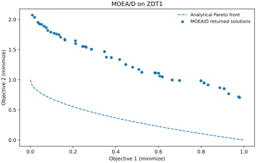

# MOEA/D

**Multiobjective Evolutionary Algorithm based on Decomposition** assigns a scalar subproblem to each weight vector and shares solutions between neighbouring subproblems [1]. This tutorial runs an unconstrained, real-coded example using the stable public API.

[All algorithms](../reference/algorithms.md) · [Configuration reference](../reference/api/algorithms/moead.md) · [Installation](../guide/installation.md)

## Run an example

Use **ZDT1 with 30 variables**, **100 subproblems**, **10,000 evaluations**, **NumPy**, and **seed 42**. The initial population counts towards the budget. These settings illustrate the workflow; they are not tuned or evidence of comparative performance.

```python
from vamos import optimize
from vamos.algorithms import MOEADConfig
from vamos.problems import ZDT1

problem = ZDT1(n_var=30)
config = MOEADConfig.default(
    pop_size=100, n_var=problem.n_var, n_obj=problem.n_obj
)
result = optimize(
    problem,
    algorithm="moead",
    algorithm_config=config,
    max_evaluations=10_000,
    engine="numpy",
    seed=42,
)
print(result.X.shape)  # (number of returned solutions, 30)
print(result.F.shape)  # (number of returned solutions, 2)
print(result.data["evaluations"])  # 10000
```

The [executable example](https://github.com/vamos-optimization/VAMOS/blob/main/examples/journeys/moead_zdt1.py) uses precisely these settings. From a checkout with VAMOS installed:

```bash
python examples/journeys/moead_zdt1.py
```

## Understand the result



*Actual run: VAMOS 1.0.0, NumPy, seed 42, 100 subproblems, 10,000 evaluations. The dashed curve is analytical, not another run.*

Each row of `X` is a decision vector and the corresponding row of `F` gives its objectives. The default result mode selects non-dominated solutions from the final population, so the number returned need not equal 100. Inspect `result.data["population"]` for the whole final population. The visible gap to the dashed curve shows that this default configuration has not converged at the chosen budget: a non-dominated result can still be far from the true front. The figure intentionally shows that residual error instead of treating budget completion as a quality guarantee.

For ZDT1 the analytical front is `f2 = 1 - sqrt(f1)`, with `0 <= f1 <= 1`. It is shown to help assess the result; it is not supplied to the optimizer. The weights used by MOEA/D are directions in objective space, **not points on that front**, and are not preferred solutions specified by a user.

To regenerate the illustration at a new path:

```bash
python -m pip install matplotlib
python examples/journeys/moead_zdt1.py --output moead-zdt1.svg
```

Existing files are refused. For a fast execution check, use `--pop-size 20 --max-evaluations 203`; this deliberately short run does not reproduce the illustration's approximation quality.

## What the configuration means

The default real-coded configuration uses differential evolution (`cr=1.0`, `f=0.5`), polynomial mutation (`eta=20`, probability `1/n_var`), PBI aggregation (`theta=5`), neighbour size 20, neighbourhood selection probability 0.9 and replacement limit 2. These are VAMOS configuration choices, not a claim that every MOEA/D variant uses them.

**VAMOS 1.3.0:** `MOEADConfig.default(variant=...)` gives jMetal's two default configurations, which are also Evolver's:

| `variant` | jMetal | Evolver | Variation | Aggregation |
| --- | --- | --- | --- | --- |
| `"de"`, MOEA/D-DE [2] | `MOEADDEBuilder` | `MOEADDEDefault` | DE rand/1/bin, `cr=1.0`, `f=0.5` | Tchebycheff |
| `"sbx"` | `MOEADBuilder` | `MOEADDoubleDefault` | SBX, `prob=0.9`, `eta=20` | PBI, `theta=5` |

Both add polynomial mutation with probability `1/n_var` (Evolver's factor 1.0) and `eta=20`, and use the same neighbourhood and replacement settings as the default above. With a discrete or mixed `encoding`, the crossover and mutation come from the encoding's defaults and the aggregation from the variant. Without `variant`, the default above stays: it differs from MOEA/D-DE only in its PBI aggregation. VAMOS 2.0 will make `"de"` the default.

| Decision | Consequence |
| --- | --- |
| Population and weights | One incumbent is associated with each weight vector; use matching cardinalities. |
| Neighbour size | Controls how many nearby weight vectors participate in local cooperation. |
| `delta` | Controls how often mating draws from the neighbourhood rather than the whole population. |
| Aggregation | PBI, Tchebycheff and weighted sum define different scalar subproblems; objective scales and front geometry affect the choice. |
| Replacement limit | Bounds how many incumbents one new solution can replace. |
| `batch_size` | The tutorial uses one generated candidate per step; changing batching changes search dynamics. |

For two objectives, `MOEADConfig.default(pop_size=100, n_obj=2, ...)` requests 99 divisions and therefore 100 uniformly spaced weights. For `m` objectives and a simplex lattice with `p` divisions, the count is `comb(p + m - 1, m - 1)`. For example, three objectives and 12 divisions give **91**, not 100. Explicit files must also contain exactly one vector per population member. Incompatible cardinalities raise an error; budget reduction is not a way to repair a mismatched configuration.

**VAMOS 1.2.0:**
- **Replacement order:** a new solution tries its neighbours in random order, as MOEA/D-DE and jMetal do; VAMOS 1.1.0 always tried them from the nearest weight vector, the subproblem itself first. The results of every MOEA/D run change. Equidistant weight vectors join a neighbourhood in index order, so runs with the same seed give the same results on every platform; the order used to depend on NumPy's platform-specific sort.
- **Packaged weights:** with three or more objectives and a `pop_size` that no complete lattice matches, `MOEADConfig.default(pop_size=...)` and `optimize` use the weight file VAMOS packages for that size, as jMetal does (for example `W3D_100.dat`, so 100 individuals with three objectives work). In VAMOS 1.1.0 this failed with a lattice-size error.
- **Defaults:** the default DE crossover with PBI aggregation is a VAMOS choice; `aggregation("tchebycheff")` with the other defaults reproduces jMetal's MOEA/D-DE.

**Development after 1.4.0:** four objectives and 100 individuals run the packaged `W4D_100.dat`, which held its vectors twice and was skipped, so VAMOS 1.4.0 ran 84 individuals for any population from 100 to 119. Every packaged weight file now loads, also from the command line, and weight files may separate their components by whitespace or commas; see the [configuration reference](../reference/api/algorithms/moead.md).

**VAMOS 1.4.0:** MOEA/D gains the choices of Evolver's MOEA/D, with jMetal's definitions. Each is off by default, and a configuration without them runs as in 1.3.0:

| Choice | How to set it | Values |
| --- | --- | --- |
| Order of the subproblems | `subproblem_order` | `"random_permutation"` (default, a new random permutation in each cycle), `"cyclic"` (0, 1, ..., `pop_size - 1`, again and again) |
| DE scheme | `crossover("de", cr=..., f=..., scheme=...)` | `"rand_1_bin"` (default), `"rand_1_exp"`, `"rand_2_bin"`, `"rand_2_exp"` [3] |
| Base of the DE mutant | `crossover("de", ..., base=...)` | `"current"` (default, the subproblem's solution, as MOEA/D-DE [2]), `"random"` (one more random parent, as Evolver's MOEA/D) |
| Aggregation | `aggregation(...)` | also `"augmented_tchebycheff"` [4] (`rho`, default `1e-4`), `"inverted_pbi"` [5] (`theta`, default `0.1`), which measures from the nadir point, and `"inverse_weight_tchebycheff"` [6], jMetal's and Evolver's modified Tchebycheff, which divides by the weights |
| Normalization of the objectives | `normalize=True` and `epsilon` (default `1e-6`) in any `aggregation(...)` | each objective becomes `(f - z*) / (z^nad - z* + epsilon)`, with the ideal point `z*` and the nadir point `z^nad` of the non-dominated solutions found so far |

The normalization makes the aggregation independent of the scale of each objective, which the decisions above leave to the user; rand/2 draws four random parents, so it needs a neighbour size of at least 4, and a random base needs one more neighbour. The [configuration reference](../reference/api/algorithms/moead.md) gives the formulas, the estimate of the nadir point and how each choice maps to Evolver's parameters.

The `n_obj` argument matters: the default factory otherwise assumes three objectives. Supply the real problem dimension and objective count as above. Its default operators are real-coded; for discrete problems, choose compatible operators through the builder or the encoding-aware optimization setup. See the [capability matrix](../reference/algorithms.md#capability-matrix).

## Constraints, archives and reproducibility

This example is unconstrained. MOEA/D supports feasibility-based comparison with the `G <= 0` convention; the [constraint reference](../reference/constraints.md) explains how to supply residuals. A scatter plot of objectives alone does not establish feasibility. **VAMOS 1.2.0:** `subproblem_update_criterion` replaces the feasibility rules by jMetal's improved epsilon method or adaptive violation threshold; see [subproblem update criteria](../reference/constraints.md#moead-subproblem-update-criteria).

An optional external archive stores non-dominated results separately from the working population. Choose `result_mode="population"` explicitly when the final population is the required output; otherwise an enabled external archive becomes the result source. The [MOEADConfig reference](../reference/api/algorithms/moead.md) documents result-archive configuration. The [stopping and archive hooks](../experiment/stopping_and_archive.md) maintain a separate objective-space observation archive. Preserve the resolved configuration, effective backend and seed with the [run lifecycle](../guide/run-artifacts.md).

## References

[1] Zhang, Q., and Li, H. (2007). [MOEA/D: A Multiobjective Evolutionary Algorithm Based on Decomposition](https://doi.org/10.1109/TEVC.2007.892759). *IEEE Transactions on Evolutionary Computation*, 11(6), 712–731.

[2] Li, H., and Zhang, Q. (2009). [Multiobjective Optimization Problems With Complicated Pareto Sets, MOEA/D and NSGA-II](https://doi.org/10.1109/TEVC.2008.925798). *IEEE Transactions on Evolutionary Computation*, 13(2), 284–302.

[3] Storn, R., and Price, K. (1997). [Differential Evolution – A Simple and Efficient Heuristic for Global Optimization over Continuous Spaces](https://doi.org/10.1023/A:1008202821328). *Journal of Global Optimization*, 11(4), 341–359.

[4] Steuer, R. E., and Choo, E.-U. (1983). [An interactive weighted Tchebycheff procedure for multiple objective programming](https://doi.org/10.1007/BF02591870). *Mathematical Programming*, 26(3), 326–344.

[5] Sato, H. (2014). [Inverted PBI in MOEA/D and its impact on the search performance on multi and many-objective optimization](https://doi.org/10.1145/2576768.2598297). *Proceedings of the 2014 Annual Conference on Genetic and Evolutionary Computation (GECCO '14)*, 645–652.

[6] Qi, Y., Ma, X., Liu, F., Jiao, L., Sun, J., and Wu, J. (2014). [MOEA/D with Adaptive Weight Adjustment](https://doi.org/10.1162/EVCO_a_00109). *Evolutionary Computation*, 22(2), 231–264.
