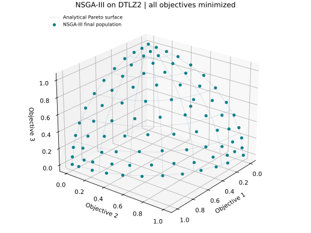

# NSGA-III

**Non-dominated Sorting Genetic Algorithm III** combines Pareto ranking with reference-direction niching to distribute a population in objective space [1]. This tutorial uses the stable public API on an unconstrained three-objective problem.

[All algorithms](../reference/algorithms.md) · [Configuration reference](../reference/api/algorithms/nsgaiii.md) · [Installation](../guide/installation.md)

## Match population and reference directions

A simplex lattice with `p` divisions and `m` objectives has `comb(p + m - 1, m - 1)` directions. Here, **three objectives** and **12 divisions** give `comb(14, 2) = 91`. The population must contain at least **91** solutions, one per direction; this example uses exactly 91. A smaller population with these divisions raises `ValueError`; VAMOS neither resizes the population nor truncates the lattice.

The directions promote coverage during survival selection. They are not a supplied Pareto front and do not guarantee one final solution in each niche.

## Run an example

Use **DTLZ2 with 12 real variables and three objectives**, **91 solutions**, **10,000 evaluations**, **NumPy**, and **seed 42**. The explicit `population` result mode makes the returned arrays easy to interpret.

```python
from math import comb

from vamos import optimize
from vamos.algorithms import NSGAIIIConfig
from vamos.problems import DTLZ2

problem = DTLZ2(n_var=12, n_obj=3)
divisions = 12
pop_size = comb(divisions + problem.n_obj - 1, problem.n_obj - 1)
config = (
    NSGAIIIConfig.builder()
    .pop_size(pop_size)
    .crossover("sbx", prob=1.0, eta=30.0)
    .mutation("pm", prob="1/n", eta=20.0)
    .selection("random")
    .reference_directions(divisions=divisions)
    .result_mode("population")
    .build()
)
result = optimize(
    problem,
    algorithm="nsgaiii",
    algorithm_config=config,
    max_evaluations=10_000,
    engine="numpy",
    seed=42,
)
print(result.X.shape)  # (91, 12)
print(result.F.shape)  # (91, 3)
print(result.data["evaluations"])  # 10000
```

The [executable example](https://github.com/vamos-optimization/VAMOS/blob/main/examples/journeys/nsgaiii_dtlz2.py) runs the same configuration. From a checkout with VAMOS installed:

```bash
python examples/journeys/nsgaiii_dtlz2.py
```

## Understand the result



*Actual run: VAMOS 1.0.0, NumPy, seed 42, 91 directions and solutions, 10,000 evaluations. The grey wireframe is analytical, not another optimization run. **Development after 1.4.0:** VAMOS 1.0.0 chose the parents by a tournament on rank and crowding distance; the example now draws them at random (see [variants and their effect](#variants-and-their-effect)), so its final population differs from the illustration's.*

All three objectives are minimized. DTLZ2's analytical Pareto surface satisfies `f1² + f2² + f3² = 1` in the positive octant. The returned vectors approach this trade-off surface; a completed budget does not prove convergence or uniform coverage. The analytical wireframe is used only for interpretation.

`result.F` is the **final population**, because the example requests it explicitly. Some rows can be dominated. Use `result.front()` to extract its non-dominated objective rows. The initial 91 evaluations count towards the total; the final offspring batch is bounded so this uninterrupted run performs exactly 10,000 evaluations.

To regenerate the illustration at a new filename:

```bash
python -m pip install matplotlib
python examples/journeys/nsgaiii_dtlz2.py --output nsgaiii-dtlz2.svg
```

Existing files are refused. A fast execution check uses `--divisions 3 --max-evaluations 203` (10 directions and solutions). It checks the workflow rather than reproducing the full illustration's quality.

## How survival works

For each generation, NSGA-III combines parents and offspring, sorts candidates into non-dominated fronts and fills the next population with complete fronts. If the next front does not fit, it normalizes objectives, associates candidates with reference directions and fills the remaining slots using niche occupancy and distance to the directions [1].

| Decision | What to check |
| --- | --- |
| Objective count and divisions | Recompute population cardinality whenever either changes. The number of directions grows combinatorially. |
| Variation | The SBX/polynomial-mutation combination above is real-coded. Discrete encodings require compatible operators. |
| Objective scaling | Niching uses normalized objectives; difficult geometry and degeneracy still affect coverage. |
| Result mode | `population` returns all survivors; `non_dominated` filters the selected result source. |
| Budget | Cover initialization and report the exact number of evaluations, rather than assuming a whole number of generations. |

For explicit reference-direction files, each row must be non-negative, sum to one and have one column per objective, and the population needs at least one individual per row. Consult the [configuration reference](../reference/api/algorithms/nsgaiii.md) for the file option.

**Development after 1.4.0:** `reference_directions(path=...)` reads the file as MOEA/D reads its weight files, with whitespace or commas between the components, so jMetal's weight files, such as the `W3D_100.dat` that VAMOS ships, can be passed as they are; VAMOS 1.4.0 read comma-separated files only. A path that is not an existing file raises `ConfigurationError` when the run starts; VAMOS 1.4.0 generated the lattice instead and saved it at that path.

### Variants and their effect

**Development after 1.4.0:** parents are chosen as the configuration says, and never by crowding distance, which is not part of NSGA-III:

| Selection | Parents |
| --- | --- |
| `selection("random")` (the default) | Drawn at random, as Deb and Jain do [1]. With constraints and feasibility first, each parent wins a binary tournament on the constraint violation: feasible beats infeasible, the smaller violation wins, and a tie, such as two feasible solutions, is drawn. This is the mating selection of the constrained version [2] and of pymoo's NSGA-III. |
| `selection("tournament", size=k)` | jMetal's NSGA-III tournament: `k` distinct solutions (2 by default) drawn at random, of which the lowest non-dominated rank wins (feasible solutions first, then by violation), with ties drawn at random. jMetal's `NSGAIIIBuilder` compares the rank and then a niche distance that its replacement never writes, so its ties are drawn too. |

Any other method (`boltzmann`, `ranking`, `sus`, ...) or option raises `ConfigurationError`. VAMOS 1.4.0 and earlier chose parents by a binary tournament on rank and crowding distance, as NSGA-II, whatever the configured selection, `"random"` included. Every NSGA-III run therefore gives other results than with VAMOS 1.4.0 for the same seed. Crowding distance favours the ends of the fronts, a selection pressure that the published algorithm does not have: on ZDT4 with 100 individuals and 25,000 evaluations (seeds 0 to 9, reference point (1.1, 1.1)), the mean hypervolume of the default configuration goes from 0.863 to 0.836.

**VAMOS 1.2.0:** `constraint_handling` replaces the feasibility-first rule by another of jMetal's constraint-handling techniques, such as epsilon-constrained or stochastic ranking: its fronts take the place of the non-dominated ones in the survival and the tournament, and niching cuts the last front that survives. See [choose a constraint-handling technique](../reference/constraints.md#choose-a-constraint-handling-technique). **Development after 1.4.0:** with a technique, `selection("random")` draws the parents at random, and only `selection("tournament")` compares the technique's fronts.

Normalization estimates the nadir point from the hyperplane through the extreme points. When the hyperplane cannot be built, or an intercept lies beyond the worst point found so far in some objective, VAMOS uses the worst point of the first front for every objective, as pymoo up to 0.4 did. pymoo 0.6 replaces only the objectives whose intercept lies beyond the worst point. The paper does not fix this rule, so both are variants, but the normalization differs in those generations.

## Scope and limitations

This tutorial's problem is unconstrained. With constraints (`G <= 0` feasible), NSGA-III puts feasible solutions first in both survival and parent selection: niching selects among the feasible solutions when more are feasible than survive, and otherwise the least violated infeasible ones fill the population. `constraint_handling` replaces that rule. Before VAMOS 1.1.0, survival ignored constraints. The [capability matrix](../reference/algorithms.md#capability-matrix) lists the constraint handling of every algorithm.

An optional external archive is distinct from the population and from the reference directions; the directions are never a solution archive. Set result mode explicitly when combining archive and population requirements. See [archives](../experiment/stopping_and_archive.md) and [saved runs](../guide/run-artifacts.md).

**VAMOS 1.2.0:** the external archive receives every evaluated offspring before survival, so an offspring that niching drops is still archived when no evaluated solution dominates it. In VAMOS 1.1.0 it received only the survivors of each generation.

The example demonstrates execution and output interpretation. It does not establish superiority over NSGA-II, MOEA/D or any other algorithm; compare multiple seeds and problem instances under a documented study protocol.

## References

[1] Deb, K., and Jain, H. (2014). [An Evolutionary Many-Objective Optimization Algorithm Using Reference-Point-Based Nondominated Sorting Approach, Part I: Solving Problems With Box Constraints](https://doi.org/10.1109/TEVC.2013.2281535). *IEEE Transactions on Evolutionary Computation*, 18(4), 577–601.

[2] Jain, H., and Deb, K. (2014). [An Evolutionary Many-Objective Optimization Algorithm Using Reference-Point Based Nondominated Sorting Approach, Part II: Handling Constraints and Extending to an Adaptive Approach](https://doi.org/10.1109/TEVC.2013.2281534). *IEEE Transactions on Evolutionary Computation*, 18(4), 602–622.
