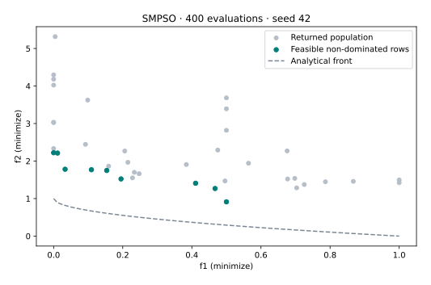

# SMPSO

Speed-constrained particle swarm optimization moves particles using velocity, personal experience and archive leaders [1]. Mutation adds perturbations; crossover is not part of this configuration.

**Goal:** run the stable public API in VAMOS 1.0.1, interpret its returned population, and identify which settings control this mechanism.

[Capability matrix](../reference/algorithms.md) · [Exact configuration reference](../reference/api/algorithms/smpso.md) · [Setup and recorded evidence](../tutorials/coverage-setup.md)

## Run the example

Prerequisite: complete [T01](../tutorials/t01-first-result.md) and the [coverage setup](../tutorials/coverage-setup.md). The protocol uses **ZDT1, 10 real variables, 2 objectives, swarm 40; 400 evaluations; NumPy; seed 42**. Initial evaluations count towards the budget. Settings are illustrative, not tuned.

```bash
python smpso.py
python smpso.py --output smpso-local.svg
```

The second command reruns the same protocol and requires Matplotlib. Use a new filename.

[Download the complete script](../assets/coverage/smpso.py).

<!-- tutorial:code -->
??? example "Complete runnable script"

    ```python
    """Verified VAMOS 1.0.1 lesson: smpso. See coverage-setup for dependencies."""


    def execute_example(problem, algorithm, config, budget, seed=42, engine="numpy"):
        import numpy as np

        from vamos import OptimizationResult, optimize

        result = optimize(problem, algorithm=algorithm, algorithm_config=config, max_evaluations=budget, seed=seed, engine=engine)
        G = result.data.get("G")
        if getattr(problem, "n_constraints", 0) and G is None:
            raise ValueError("Declared constraints are missing from the returned result.")
        feasible_rows = np.arange(len(result.F)) if G is None else np.flatnonzero(np.all(G <= 0, axis=1))
        if len(feasible_rows):
            feasible = OptimizationResult({"X": result.X[feasible_rows], "F": result.F[feasible_rows]})
            front, local = feasible.front(return_indices=True)
            front_rows = feasible_rows[local]
        else:
            front, front_rows = np.empty((0, problem.n_obj)), np.empty(0, dtype=int)
        print(f"Algorithm: {algorithm}; encoding: {problem.encoding}; backend: {engine}; seed: {seed}")
        print(f"Returned X: {result.X.shape}; F: {result.F.shape}; result mode: population")
        print(f"Feasible rows: {len(feasible_rows)}/{len(result.F)}; feasible non-dominated rows: {len(front)}")
        print(f"Evaluations: {result.data['evaluations']}")
        return {
            "problem": problem,
            "algorithm": algorithm,
            "config": config,
            "result": result,
            "feasible_rows": feasible_rows,
            "front": front,
            "front_rows": front_rows,
        }


    def run_smpso(budget=400):
        from vamos.algorithms import SMPSOConfig
        from vamos.problems import ZDT1

        problem = ZDT1(n_var=10)
        config = (
            SMPSOConfig.builder()
            .pop_size(40)
            .archive_size(40)
            .mutation("pm", prob=1.0 / problem.n_var, eta=20.0)
            .inertia(0.1)
            .c1(1.5)
            .c2(1.5)
            .vmax_fraction(0.5)
            .result_mode("population")
            .build()
        )
        return execute_example(problem, "smpso", config, budget)


    def plot_example(data, output):
        from pathlib import Path

        import matplotlib

        matplotlib.use("Agg")
        import matplotlib.pyplot as plt
        import numpy as np

        output = Path(output)
        if output.exists():
            raise FileExistsError(f"Choose a new figure filename: {output}")
        if output.suffix.lower() != ".svg":
            raise ValueError("Use an .svg output filename.")
        f = data["result"].F
        with plt.rc_context({"svg.hashsalt": "vamos-coverage", "svg.fonttype": "none"}):
            fig = plt.figure(figsize=(7, 4.5), layout="constrained")
            if f.shape[1] == 3:
                ax = fig.add_subplot(projection="3d")
                ax.scatter(*f.T, c="#007f7a", s=22)
                ax.set(xlabel="f1", ylabel="f2", zlabel="f3")
                ax.set_box_aspect((1, 1, 0.85), zoom=0.85)
            else:
                ax = fig.add_subplot()
                ax.scatter(*f.T, c="#b6bec8", s=25, label="Returned population")
                if len(data["front"]):
                    ax.scatter(*data["front"].T, c="#007f7a", s=30, label="Feasible non-dominated rows")
                labels = {
                    "WeldedBeamDesignProblem": ("Cost (minimize)", "Deflection proxy (minimize)"),
                    "FeatureSelectionProblem": ("Validation error (minimize)", "Feature count (minimize)"),
                    "HyperparameterTuningProblem": ("Validation error (minimize)", "Complexity proxy (minimize)"),
                }
                xlabel, ylabel = labels.get(type(data["problem"]).__name__, ("f1 (minimize)", "f2 (minimize)"))
                ax.set(xlabel=xlabel, ylabel=ylabel)
                ax.legend()
            if data["problem"].__class__.__name__ in {"ZDT1", "ZDT1Problem"}:
                x = np.linspace(0, 1, 101)
                ax.plot(x, 1 - np.sqrt(x), "--", c="#7c8795", label="Analytical front")
                ax.legend()
            ax.set_title(f"{data['algorithm'].upper()} · {data['result'].data['evaluations']} evaluations · seed 42")
            fig.savefig(output, metadata={"Date": None}, bbox_inches="tight", pad_inches=0.25)
            plt.close(fig)
        output.write_text("\n".join(line.rstrip() for line in output.read_text(encoding="utf-8").splitlines()) + "\n", encoding="utf-8")


    def lesson_cli(function, default_budget=400):
        import argparse

        parser = argparse.ArgumentParser(description="Run a bounded VAMOS example and optionally plot its actual result.")
        parser.add_argument("--budget", type=int, default=default_budget)
        parser.add_argument("--output", help="New SVG filename; requires Matplotlib")
        args = parser.parse_args()
        data = function(budget=args.budget)
        if args.output:
            plot_example(data, args.output)


    if __name__ == "__main__":
        lesson_cli(run_smpso, default_budget=400)
    ```
<!-- /tutorial:code -->

### Recorded output

<!-- tutorial:output -->
```text
Algorithm: smpso; encoding: real; backend: numpy; seed: 42
Returned X: (40, 10); F: (40, 2); result mode: population
Feasible rows: 40/40; feasible non-dominated rows: 9
Evaluations: 400
```
<!-- /tutorial:output -->



*Measured with VAMOS 1.0.1; the [observations and provenance](../tutorials/coverage-setup.md#recorded-evidence) retain the inputs and results.*

## Understand the configuration

| Setting | Meaning in this example |
| --- | --- |
| `archive_size(40)` | Capacity of the leaders archive used by the swarm. |
| `inertia(0.1)` | Contribution of the previous velocity. |
| `c1(1.5)`, `c2(1.5)` | Personal-best and leader attraction coefficients. |
| `vmax_fraction(0.5)` | Bounds velocity relative to each variable’s range. |
| Polynomial mutation | Additional real-valued perturbation, probability `1/10`. |

## Interpret the result and its limits

Each `X` row aligns with the same `F` row. This lesson explicitly requests `population` mode, then computes the feasible non-dominated subset separately. All objectives are minimized. A non-dominated row is only non-dominated among the available rows; it need not be Pareto optimal. The retained [observations](../assets/coverage/observations.json) contain the actual arrays and configuration.

In VAMOS 1.0.1, explicit population mode returns the final swarm. The leaders archive and optional external result archive remain separate. Standalone binary, integer and permutation problems are rejected; mixed problems require mixed-compatible mutation. This real-valued run does not verify every supported combination.

This run has no constraints. Before using a constrained or discrete problem, check the [capability matrix](../reference/algorithms.md#capability-matrix) and [constraint convention](../reference/constraints.md). Preserve complete runs through the [canonical lifecycle](../guide/run-artifacts.md); the teaching JSON is not a replay bundle.

## Try one controlled change

Keep the budget and all other fields fixed, reduce `vmax_fraction` to 0.25, and compare the spread. Follow with repeated seeds; a single swarm realization is not evidence of a better default.

**Next:** use [T06](../tutorials/t06-fair-study.md) to turn this example into a reproducible comparison.

## References

[1] Nebro, A. J., Durillo, J. J., García-Nieto, J., Coello Coello, C. A., Luna, F., and Alba, E. (2009). [SMPSO: A new PSO-based metaheuristic for multi-objective optimization](https://doi.org/10.1109/MCDM.2009.4938830). *IEEE Symposium on Computational Intelligence in Multi-Criteria Decision-Making*.
