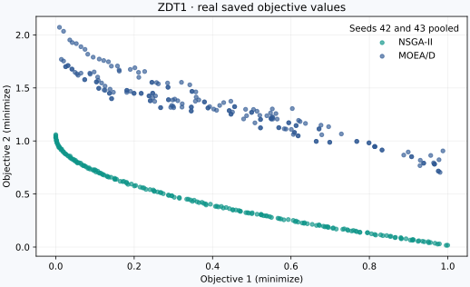

# VAMOS Studio

**Status: Experimental.** Studio is a local Panel application for exploring
saved studies, viewing objective values, and inspecting candidate solutions.
Its interface and ranking helpers are outside the stable VAMOS 1.x contract;
see [Stability and versioning](../project/stability-and-versioning.md).

## See a real study



*Real optimization output generated with VAMOS 1.0.0, not a Studio screenshot:
ZDT1, NSGA-II and MOEA/D, seeds 42 and 43, population 100, NumPy backend,
10,000 evaluations per run. The two seeds are pooled for each algorithm.
This is a walkthrough dataset, not evidence that one algorithm is better.*

This guide targets **VAMOS 1.1.0**. The launcher now serves the application
and honors its study directory. Users of 1.0.2 should upgrade to obtain these
fixes and the durable batch and comparison pages described here.

### Prepare the same data

Install the [published package](installation.md), then download
[`prepare_studio_demo.py`](https://github.com/vamos-optimization/VAMOS/blob/main/examples/journeys/prepare_studio_demo.py)
using GitHub's **Download raw file** action. Run it from the folder containing
the downloaded script:

```bash
python prepare_studio_demo.py --output results/studio-demo
vamos study inspect results/studio-demo
vamos study summarize results/studio-demo
```

The script uses only the stable public API. It plans and executes **4 runs with
a total budget of 40,000 evaluations**, then verifies that all four completed.
Choose a new output directory if that path already exists. In a repository
checkout, the script is at `examples/journeys/prepare_studio_demo.py`.

The two `vamos study` commands work independently of Studio. They inspect
persisted data without running the optimizers again. For a broader experiment,
follow the [reproducible study guide](studies.md).

To regenerate the figure above, install the `analysis` extra and add
`--plot studio-study.svg` to the script command, again choosing a fresh study
output directory. The figure plots the saved objective values without modifying
or filtering them.

### Read the Results Explorer

With Studio running:

1. Open **Explore Results** in the sidebar.
2. Set **Study directory or search folder** to the study root, such as
   `results/studio-demo`, or to a folder that contains studies, such as
   `results`, and click **Find studies**. Choose the study under **Study** and
   click **Load study**.
3. Check the status: this example should say **Loaded 4 runs, 2 fronts**.
   A loading error means your study was not loaded. Synthetic demo fronts
   appear only after you click **Load demo data**, and are labelled as such.
4. Inspect **Pareto Fronts** for the chosen **Problem**. Hover over points to
   read `f1` and `f2`; click a legend entry to hide or show an algorithm. Both
   ZDT1 objectives are minimized, so improvements move toward the lower left.
5. Change **MCDM method** or **Top solutions per front** to explore
   **Solution Rankings**. Ranks are calculated separately for each algorithm's
   pooled solutions; they are not ranks of algorithms or a statistical
   comparison, which the **Statistical Comparison** page provides.

Studio displays the saved objective vectors. A returned population can contain
dominated points, and the plot title does not certify that every point is
non-dominated or lies on the true Pareto front. See
[Understanding results](understanding-results.md) for those distinctions.

The overlay shows the fronts of one problem at a time: two or three objectives
as a scatter plot, more as parallel coordinates. **Filters** narrow the overlay
and the ranking to the solutions that satisfy every constraint, or whose
objectives lie inside the ranges you set with one slider per objective; the
page reports how many solutions remain. Runs that stored no constraint values
count every solution as feasible. **Export ranking (CSV)** downloads the
ranking table shown on the page, filters included. Use the
[analysis workflow](../topics/analysis.md) for controlled plots and exports.

## Installation and launch options

Studio's optional dependencies are installed from PyPI:

```bash
python -m pip install "vamos-optimization[studio]==1.1.0"
```

The packaged command and its intended study-root argument are:

```bash
vamos studio --study-dir results/studio-demo
```

The server binds to `127.0.0.1:5006` by default. To choose another loopback
address or port:

```bash
vamos studio --address ::1 --port 5010 --study-dir results/studio-demo
```

With an IPv6 address, open Studio at `http://localhost:5010/app`.

A non-loopback address is rejected unless you separately acknowledge the
network exposure:

```bash
vamos studio --address 0.0.0.0 --allow-remote-binding --no-browser
```

Remote binding exposes an experimental local application to other network
users. Apply operating-system firewall and access controls appropriate to the
environment; Studio does not provide an authentication boundary.

Browsers open Studio sessions only from pages served under an allowed
`host:port`. With a wildcard address such as `0.0.0.0`, these are `localhost`
and this computer's host names and IPv4 addresses; with a specific address,
`localhost` and that address. Allow any other name, such as a reverse proxy or
DNS alias, with `--allow-websocket-origin`, once per name:

```bash
vamos studio --address 0.0.0.0 --allow-remote-binding --no-browser --allow-websocket-origin studio.example.org:443
```

## Pages

- **Problems & Algorithms** lists the registered problems and the built-in
  algorithms, and opens either in Run Experiment.
- **Problem Builder** defines a problem in Python, or starts from a template
  with its bounds and constraints, previews its Pareto front, runs it with a
  configurable algorithm and generates a standalone script.
- **Run Experiment** runs a registered problem, with the number of variables
  and, where the problem allows it, of objectives that you choose, and lets
  you browse the population of every generation.
- **Batch Comparison** runs several algorithms on several problems for
  consecutive seeds as a durable study in a background process, follows its
  progress, and reports hypervolume with CSV and LaTeX downloads.
- **Statistical Comparison** tests whether the algorithms of a study differ and
  exports the evidence as LaTeX tables, CSV, and SAES files.
- **Explore Results** loads a study, overlays the fronts of each problem,
  filters them, ranks solutions with MCDM methods, exports the ranking as CSV,
  and opens a run in Run Experiment to run it again.

The **Environment** panel at the bottom of the sidebar lists the VAMOS and
Python versions, the installed kernel backends, and which optional extras are
installed. Studio reads them from the installed package metadata without
importing the backends.

## Problems and algorithms

The **Problems** tab lists every registered problem with its encoding, its
default numbers of variables and objectives, whether you can choose the number
of objectives, whether VAMOS ships its reference front for that number of
objectives, and the algorithms that have operators for its encoding. Filter by
encoding or search by key, name or description, and select a problem to read
its description.

The **Algorithms** tab shows the configurable parameters of an algorithm for a
problem encoding, with their VAMOS defaults and allowed values. They come from
the same tuning configuration space that Customize offers and `vamos tune`
explores. Defaults are shown for the selected problem when its encoding
matches, and otherwise for the first registered problem of that encoding,
because some defaults depend on the problem's dimensions.

**Open in Run Experiment** opens the selected problem, or the algorithm with
that problem, in Run Experiment.

## Running a stored run again

In Explore Results, **Run again** lists the runs of the chosen problem. **Run
again in Run Experiment** opens the run's problem, numbers of variables and
objectives, algorithm, population size, evaluation budget, and seed in Run
Experiment, which says what it could not carry over:

- A run that used its algorithm's VAMOS default configuration runs with the
  same default. When the run was made with another VAMOS version, Studio warns
  that the defaults may differ.
- A run that was given its own algorithm configuration starts from the VAMOS
  default configuration instead, because Studio cannot load a stored
  configuration into its form. `vamos reproduce <run directory>` repeats such a
  run exactly.
- Run Experiment always uses the NumPy engine and an evaluation budget of at
  least 100 evaluations.

The seed is the run's own. For a NumPy run with the default configuration and
a budget of at least 100 evaluations, made with the same VAMOS version, Run
Experiment therefore follows the same trajectory; change the seed to run
another replicate.

Problem Builder and Run Experiment start a single run in the background, so
the rest of Studio stays responsive while it runs. Run Experiment follows the
run every second, with its progress through the evaluation budget, the current
generation and the front recorded so far. Its **Stop** button ends the run after
the current generation and keeps every front recorded up to then. The Problem
Builder runs your code in a child process and shows the time elapsed. Its
**Stop** button ends that process, and nothing from the run is kept. Leaving
either page stops its run. These runs end with the Studio server and are not
saved as studies, so use Batch Comparison for runs that need to last or be
compared.

## Batch studies

A batch is an ordinary StudyManifest study, created in the Studio folder
(`--study-dir`) under a `batch-<date>-<time>` name unless you give it one.
**Check plan** resolves the exact plan with `plan_study` without writing
anything: the number of runs, the total evaluation budget, the population sizes,
and any reason the batch cannot run, such as a population that does not match
an algorithm's reference directions. **Create and run** publishes the study with
`create_study` and starts a background process that owns it, as
`vamos study run` would.

The background process keeps running if you close the browser or stop the
Studio server; opening the page again reconnects to it. Studio keeps the
process's heartbeat, outcome, and log next to the study, in
`.vamos-studio/jobs/<study-id>/`, and never writes inside the study itself.

**Stop** addresses a request to the current worker's unique token. The worker
checks requests every 0.25 seconds and interrupts its owning thread, allowing
file cleanup to finish before reporting a stop. A native calculation must
return control to Python before that interruption can take effect. Studio never
signals a process by its id, which the system may have given to another
program after a crash. Studio shows **stopping** until the worker acknowledges
the request; a stale heartbeat is reported as lost, not as a confirmed stop.
The run in progress is lost and
the study stays `running`; **Resume** reconciles the study and continues with
the pending runs, rerunning the interrupted one. Resuming requires the same
runtime and dependency build that produced the earlier runs. **Retry failed
runs** retries the failed runs that the study classifies as retryable.

Studio does not lock a study. A study that is marked `running` without a Studio
process may be running in another process, such as `vamos study run` in a
terminal; Studio asks you to confirm that no other process owns it before
resuming it.

## Algorithm configuration

Algorithms run with their VAMOS default configuration unless you choose
**Customize**. The customization controls come from the algorithm's tuning
configuration space for the problem encoding, the same space that `vamos tune`
explores, so only operators and conditional parameters that VAMOS can build are
offered. Studio applies only the configuration fields you change on top of the
default configuration and lists every difference before the run. When a VAMOS
default lies outside the tuning range, Studio keeps it and says so.

NSGA-III, RVEA, and MOEA/D with three or more objectives take their population
size from their reference directions or weight vectors, so Studio shows that
size instead of accepting another one. For binary, integer, permutation, and
mixed problems, some algorithms have no default operators for the encoding;
Studio warns about them, and Customize offers operators for that encoding.

A script generated from a customized configuration rebuilds it with the
configuration class's `from_dict`; otherwise the script uses the default
configuration and the chosen population size.

## Batch hypervolume

Batch Comparison computes the hypervolume of each run's feasible final front on
objectives normalized per problem with the ideal and nadir points of all the
fronts of that batch, using 1.1 as the reference point in every objective.
Values compare algorithms and seeds within one batch; they are not comparable
across batches or problems.

## Statistical comparison

Statistical Comparison reads the successful runs of a study and computes, per
run, the batch-normalized hypervolume (higher is better) and, when VAMOS ships a
reference front with the problem's number of objectives, IGD+ on objectives
normalized by that front (lower is better). One algorithm is the pivot.

- **Verdict** and **Comparisons** compare every algorithm with the pivot on
  every problem with a two-sided Mann-Whitney test, Holm or Benjamini-Hochberg
  correction, and the Vargha-Delaney A12 effect size. A mark is `+` or `-` only
  when the corrected p-value is below the significance level. The page says
  when the number of runs makes a significant result impossible; no significant
  difference is not evidence that two algorithms perform the same.
- **Ranking** gives the average rank of each algorithm's median over the
  problems, the Friedman test, a Nemenyi critical-difference diagram, and
  Holm's post-hoc test against the pivot. With fewer than five problems these
  tests have little power.
- **Distributions**, **Fronts** (the median run of each algorithm), and
  **Attainment** (empirical attainment surfaces of two-objective problems)
  show the data behind the tests; **Cost** shows the median runtime.

The exports are a LaTeX table of medians and interquartile ranges with the
marks, a LaTeX ranking table, the comparisons as CSV, and the long-format
results and metrics files that the SAES tool reads.

## Trusted local Python

The **Problem Builder** can compile and execute Python entered by the user or
generated by an LLM. This is disabled by default. Before a preview can run,
Studio displays the complete objective and constraint code and requires the
user to select an explicit acknowledgement for the current code. Editing or
regenerating that code clears the acknowledgement.

> Trusted local Python code executes with the permissions of your current
> operating-system user. Review the complete code before opting in.

Generated code is never executed automatically. Syntax-tree validation,
restricted built-ins, a child process, timeouts, and best-effort resource
limits reject some unsupported inputs and reduce accidental damage; they do
not isolate untrusted Python and are not a security boundary. Do not opt in for
code from an untrusted source. Studio does not log generated code or API-key
values.

A preview reports a timeout when its elapsed-time limit expires or the
operating system reports an exhausted CPU budget. Other worker failures
remain distinct errors.

Generating a standalone script only displays text; running that exported
script remains a separate user action outside Studio.

## Data-only exploration

Explore Results reads `vamos.run-manifest` and StudyManifest artifacts through
`load_run`, `load_result`, and `load_study`. It does not resolve plugins,
reconstruct components, or invoke replay. Use the explicit stable
`vamos reproduce` command when execution is intended. **Find studies** lists
the canonical studies at or below the chosen folder. A study that cannot be
loaded is reported as an error; synthetic demo fronts appear only after you
choose **Load demo data**, and are labelled as such.

Studio also provides experimental ranking and export helpers. These features
are not part of the stable VAMOS 1.x compatibility surface.

## Optional dependencies

Interactive plots and tables use Panel, Plotly, and pandas from the `studio`
extra. Provider-backed code generation may require a provider-specific API key.
Prefer environment-based credentials; values entered in the password field are
held only in the running process and are not included in Studio status output.
