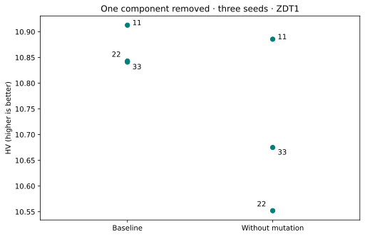

# Remove one component in a controlled study

**Goal:** ask whether polynomial mutation changes outcomes under one fixed experimental design. This example uses the stable [StudySpec and lifecycle](../reference/api/study-specification.md). It does not require the separate Experimental ablation CLI.

Both variants use NSGA-II on 10-variable ZDT1, population/offspring 40, SBX probability 0.9 and eta 20, tournament size 2, NumPy, seeds 11/22/33 and 400 evaluations per run. **Only polynomial-mutation probability changes: 0.1 versus 0.0.** Initial evaluations count towards the budget. Two variants × three seeds × 400 evaluations = **2,400 planned evaluations**.

Each variant gets its own immutable StudySpec. The script plans both before optimization and checks that creation preserves plan identity. It verifies successful run artifacts, loads their real fronts and computes HV against the fixed reference `[1.1, 11]`.

## Run the complete example

Prerequisites: [coverage setup](coverage-setup.md) and [T06–T08](t06-fair-study.md). Download the script below and choose a new output directory. The wrapper refuses an existing directory.

```bash
python ablation.py --output ablation-example
```

[Download the complete script](../assets/coverage/ablation.py).

<!-- tutorial:code -->
??? example "Complete runnable script"

    ```python
    """Verified VAMOS 1.0.1 lesson: ablation. See coverage-setup for dependencies."""


    def new_output(output):
        from pathlib import Path

        path = Path(output)
        path.mkdir(parents=True, exist_ok=False)
        return path


    def write_observations(output, data):
        import json

        (output / "observations.json").write_text(json.dumps(data, indent=2, allow_nan=False) + "\n", encoding="utf-8")
        return data


    def run_ablation_example(output, budget=400, seeds=(11, 22, 33)):
        from pathlib import Path

        from moocore import hypervolume

        from vamos import StudySpec, create_study, load_result, plan_study, verify_run
        from vamos.algorithms import NSGAIIConfig

        if budget < 40 or budget % 40 or not seeds or len(set(seeds)) != len(seeds):
            raise ValueError("Use distinct seeds and a positive budget divisible by population 40.")
        output = new_output(output)
        specs = {}
        for name, probability in (("baseline", 0.1), ("without-mutation", 0.0)):
            config = (
                NSGAIIConfig.builder()
                .pop_size(40)
                .offspring_size(40)
                .crossover("sbx", prob=0.9, eta=20.0)
                .mutation("pm", prob=probability, eta=20.0)
                .selection("tournament", size=2)
                .result_mode("population")
                .build()
            )
            specs[name] = StudySpec(
                problems=["zdt1"],
                algorithms=["nsgaii"],
                seeds=seeds,
                n_var=10,
                pop_size=40,
                max_evaluations=budget,
                engine="numpy",
                algorithm_configs={"nsgaii": config.to_dict()},
                labels={"workflow": "controlled-ablation", "variant": name},
                on_error="continue",
            )
        plans = {name: plan_study(spec, output=output / name) for name, spec in specs.items()}
        if any(plan.status != "ready" for plan in plans.values()):
            raise ValueError("An ablation plan is not ready.")
        print(
            f"Planned tasks: {sum(p.task_count for p in plans.values())}; evaluations: {sum(p.total_evaluation_budget for p in plans.values())}"
        )
        data = {"kind": "ablation", "reference_point": [1.1, 11.0], "budget": budget, "rows": []}
        for name, spec in specs.items():
            study = create_study(spec, output=output / name).run()
            if study.plan_id != plans[name].plan_id:
                raise RuntimeError("Created plan differs from the reviewed plan.")
            for row in study.summarize().rows:
                record = {
                    "variant": name,
                    "seed": row.seed,
                    "study_id": study.study_id,
                    "task_id": row.task_id,
                    "run_id": row.selected_run_id,
                    "state": row.state,
                    "hv": None,
                }
                if row.state == "succeeded":
                    run_path = study.root / Path(row.run_manifest_path).parent
                    verification = verify_run(run_path)
                    if verification.run_id != row.selected_run_id or verification.numerical_bundle_safety != "valid":
                        raise ValueError("A successful ablation run failed verification.")
                    result = load_result(run_path)
                    front = result.front()
                    record.update(
                        evaluations=int(result.data["evaluations"]),
                        front=front.tolist(),
                        hv=float(hypervolume(front, ref=data["reference_point"])),
                    )
                data["rows"].append(record)
        write_observations(output, data)
        if any(row["state"] != "succeeded" for row in data["rows"]):
            raise RuntimeError("Failures retained in observations.json; do not compare incomplete variants.")
        for row in data["rows"]:
            print(f"{row['variant']}: seed {row['seed']}; evaluations {row['evaluations']}; HV {row['hv']:.6f}")
        print("One removed component, three seeds, one problem: descriptive evidence only.")
        return data


    def advanced_cli(function):
        import argparse

        parser = argparse.ArgumentParser(description="Run a bounded workflow in a new output directory.")
        parser.add_argument("--output", required=True)
        args = parser.parse_args()
        function(args.output)


    if __name__ == "__main__":
        advanced_cli(run_ablation_example)
    ```
<!-- /tutorial:code -->

### Recorded output

<!-- tutorial:output -->
```text
Planned tasks: 6; evaluations: 2400
baseline: seed 11; evaluations 400; HV 10.912801
baseline: seed 22; evaluations 400; HV 10.843059
baseline: seed 33; evaluations 400; HV 10.841080
without-mutation: seed 11; evaluations 400; HV 10.885577
without-mutation: seed 22; evaluations 400; HV 10.552095
without-mutation: seed 33; evaluations 400; HV 10.675069
One removed component, three seeds, one problem: descriptive evidence only.
```
<!-- /tutorial:output -->



*Measured with VAMOS 1.0.1; the [observations and provenance](coverage-setup.md#recorded-evidence) retain the inputs and results.*

## Interpret the measurements and limits

The output contains two complete canonical studies and a derived `observations.json` retaining study/task/run identities, states, evaluation counts, fronts and measured HV. Failures remain present with unavailable metrics; the comparison stops rather than replacing them with zero. Use the [study recovery guide](../guide/studies.md) to investigate or resume original studies.

The figure displays each seed, without smoothing or invented uncertainty bands. Shared numeric seeds improve protocol traceability, but stochastic paths can consume random numbers differently; this alone does not justify a paired statistical test. Three seeds on one easy problem support a descriptive comparison of these settings. They do not establish that mutation is universally beneficial, that the configuration is tuned, or that the two variants are equivalent.

The retained front arrays permit independent recomputation of every plotted HV. Full replay requires the original canonical study/run artifacts and a matching material environment, not the teaching observation file alone.

## Try one controlled change

Add seeds 44 and 55 to both variants, preserving every other field. The first-attempt budget becomes 4,000 evaluations. Compare spread as well as a central value, and define the question before introducing additional ablations.

**Next:** use [T08](t08-study-report.md) to report a prespecified experiment with its failures, assumptions and evidence. Consult [stability and versioning](../project/stability-and-versioning.md) before depending on Experimental interfaces.
