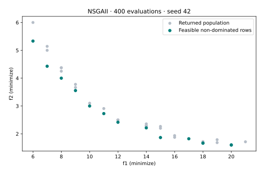
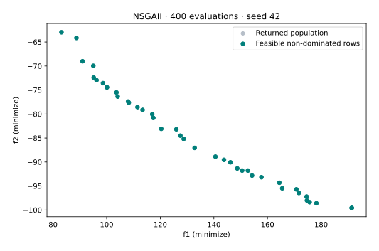
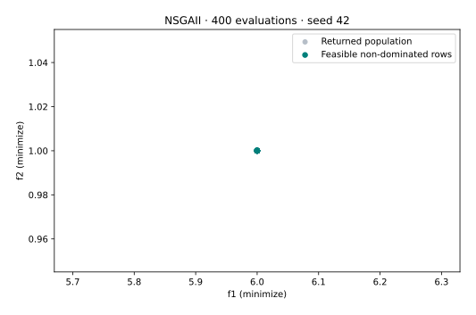
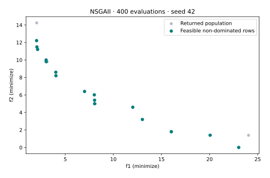

# Choose a decision representation

**Goal:** choose operators that preserve the meaning of a decision, then verify the returned domains. Complete [T01](t01-first-result.md) first and install the [coverage environment](coverage-setup.md). Real-valued ZDT1 is already covered by T01; the four examples below use NSGA-II, NumPy, seed 42, population/offspring 40 and 400 evaluations each.

The [problem catalogue](../reference/problems.md) defines the built-ins, and the [problem protocol](../reference/api/problem-definition.md) defines bounds, encoding and mixed-variable metadata. An array’s floating dtype does not make a discrete variable continuous. The script checks values and bounds, rather than inferring validity from dtype.

## Binary masks

`zdt5` uses 80 binary decisions in its default formulation. Uniform crossover exchanges bit choices; bit-flip mutation changes them. ZDT5 is a synthetic optimization problem, not a feature-selection model.

```bash
python binary.py
python binary.py --output binary-local.svg
```

[Download the complete script](../assets/coverage/binary.py).

<!-- tutorial:code-binary -->
??? example "Complete runnable script"

    ```python
    """Verified VAMOS 1.0.1 lesson: binary. See coverage-setup for dependencies."""


    def execute_example(problem, algorithm, config, budget, seed=42, engine="numpy"):
        import numpy as np

        from vamos import OptimizationResult, optimize

        result = optimize(problem, algorithm=algorithm, algorithm_config=config, max_evaluations=budget, seed=seed, engine=engine)
        G = result.data.get("G")
        if getattr(problem, "n_constraints", 0) and G is None:
            raise ValueError("Declared constraints are missing from the returned result.")
        feasible_rows = np.arange(len(result.F)) if G is None else np.flatnonzero(np.all(G <= 0, axis=1))
        if len(feasible_rows):
            feasible = OptimizationResult({"X": result.X[feasible_rows], "F": result.F[feasible_rows]})
            front, local = feasible.front(return_indices=True)
            front_rows = feasible_rows[local]
        else:
            front, front_rows = np.empty((0, problem.n_obj)), np.empty(0, dtype=int)
        print(f"Algorithm: {algorithm}; encoding: {problem.encoding}; backend: {engine}; seed: {seed}")
        print(f"Returned X: {result.X.shape}; F: {result.F.shape}; result mode: population")
        print(f"Feasible rows: {len(feasible_rows)}/{len(result.F)}; feasible non-dominated rows: {len(front)}")
        print(f"Evaluations: {result.data['evaluations']}")
        return {
            "problem": problem,
            "algorithm": algorithm,
            "config": config,
            "result": result,
            "feasible_rows": feasible_rows,
            "front": front,
            "front_rows": front_rows,
        }


    def run_encoding(encoding="binary", budget=400):
        import numpy as np

        from vamos import make_problem_selection
        from vamos.algorithms import NSGAIIConfig

        choices = {
            "binary": ("zdt5", "uniform", "bitflip"),
            "integer": ("int_alloc", "uniform", "reset"),
            "permutation": ("tsp6", "ox", "swap"),
            "mixed": ("mixed_design", "mixed", "mixed"),
        }
        name, crossover, mutation = choices[encoding]
        problem = make_problem_selection(name).instantiate()
        config = (
            NSGAIIConfig.builder()
            .pop_size(40)
            .offspring_size(40)
            .crossover(crossover, prob=0.9)
            .mutation(mutation, prob=1.0 / problem.n_var)
            .selection("tournament", size=2)
            .result_mode("population")
            .build()
        )
        data = execute_example(problem, "nsgaii", config, budget)
        x = data["result"].X
        if encoding == "binary":
            valid = np.isin(x, [0, 1]).all()
        elif encoding == "permutation":
            valid = (np.sort(x, axis=1) == np.arange(problem.n_var)).all()
        else:
            discrete = (
                np.arange(problem.n_var)
                if encoding == "integer"
                else np.concatenate([problem.mixed_spec["int_idx"], problem.mixed_spec["cat_idx"]])
            )
            valid = np.equal(x[:, discrete], np.rint(x[:, discrete])).all()
        valid = bool(valid and np.all(x >= problem.xl) and np.all(x <= problem.xu))
        if not valid:
            raise ValueError("Returned decisions violate the representation's domains.")
        print(f"Domain checks: passed for {encoding}")
        return data


    def plot_example(data, output):
        from pathlib import Path

        import matplotlib

        matplotlib.use("Agg")
        import matplotlib.pyplot as plt
        import numpy as np

        output = Path(output)
        if output.exists():
            raise FileExistsError(f"Choose a new figure filename: {output}")
        if output.suffix.lower() != ".svg":
            raise ValueError("Use an .svg output filename.")
        f = data["result"].F
        with plt.rc_context({"svg.hashsalt": "vamos-coverage", "svg.fonttype": "none"}):
            fig = plt.figure(figsize=(7, 4.5), layout="constrained")
            if f.shape[1] == 3:
                ax = fig.add_subplot(projection="3d")
                ax.scatter(*f.T, c="#007f7a", s=22)
                ax.set(xlabel="f1", ylabel="f2", zlabel="f3")
                ax.set_box_aspect((1, 1, 0.85), zoom=0.85)
            else:
                ax = fig.add_subplot()
                ax.scatter(*f.T, c="#b6bec8", s=25, label="Returned population")
                if len(data["front"]):
                    ax.scatter(*data["front"].T, c="#007f7a", s=30, label="Feasible non-dominated rows")
                labels = {
                    "WeldedBeamDesignProblem": ("Cost (minimize)", "Deflection proxy (minimize)"),
                    "FeatureSelectionProblem": ("Validation error (minimize)", "Feature count (minimize)"),
                    "HyperparameterTuningProblem": ("Validation error (minimize)", "Complexity proxy (minimize)"),
                }
                xlabel, ylabel = labels.get(type(data["problem"]).__name__, ("f1 (minimize)", "f2 (minimize)"))
                ax.set(xlabel=xlabel, ylabel=ylabel)
                ax.legend()
            if data["problem"].__class__.__name__ in {"ZDT1", "ZDT1Problem"}:
                x = np.linspace(0, 1, 101)
                ax.plot(x, 1 - np.sqrt(x), "--", c="#7c8795", label="Analytical front")
                ax.legend()
            ax.set_title(f"{data['algorithm'].upper()} · {data['result'].data['evaluations']} evaluations · seed 42")
            fig.savefig(output, metadata={"Date": None}, bbox_inches="tight", pad_inches=0.25)
            plt.close(fig)
        output.write_text("\n".join(line.rstrip() for line in output.read_text(encoding="utf-8").splitlines()) + "\n", encoding="utf-8")


    def lesson_cli(function, default_budget=400):
        import argparse

        parser = argparse.ArgumentParser(description="Run a bounded VAMOS example and optionally plot its actual result.")
        parser.add_argument("--budget", type=int, default=default_budget)
        parser.add_argument("--output", help="New SVG filename; requires Matplotlib")
        args = parser.parse_args()
        data = function(budget=args.budget)
        if args.output:
            plot_example(data, args.output)


    def run_lesson(budget=400):
        return run_encoding("binary", budget)


    if __name__ == "__main__":
        lesson_cli(run_lesson, default_budget=400)
    ```
<!-- /tutorial:code-binary -->

### Recorded output

<!-- tutorial:output-binary -->
```text
Algorithm: nsgaii; encoding: binary; backend: numpy; seed: 42
Returned X: (40, 80); F: (40, 2); result mode: population
Feasible rows: 40/40; feasible non-dominated rows: 14
Evaluations: 400
Domain checks: passed for binary
```
<!-- /tutorial:output-binary -->



*Measured with VAMOS 1.0.1; the [observations and provenance](coverage-setup.md#recorded-evidence) retain the inputs and results.*

Every returned entry must be 0 or 1. The nominal mutation probability is `1/n_var`; a binary representation needs more than rounding the output of a real-valued operator.

**Try one change:** increase the budget to 800 without changing the representation, operators or seed. Check domain validity again before interpreting any objective improvement.

## Bounded integers

`int_alloc` uses 20 integer decisions by default. Uniform crossover and reset mutation preserve the discrete allocation domains.

```bash
python integer.py
python integer.py --output integer-local.svg
```

[Download the complete script](../assets/coverage/integer.py).

<!-- tutorial:code-integer -->
??? example "Complete runnable script"

    ```python
    """Verified VAMOS 1.0.1 lesson: integer. See coverage-setup for dependencies."""


    def execute_example(problem, algorithm, config, budget, seed=42, engine="numpy"):
        import numpy as np

        from vamos import OptimizationResult, optimize

        result = optimize(problem, algorithm=algorithm, algorithm_config=config, max_evaluations=budget, seed=seed, engine=engine)
        G = result.data.get("G")
        if getattr(problem, "n_constraints", 0) and G is None:
            raise ValueError("Declared constraints are missing from the returned result.")
        feasible_rows = np.arange(len(result.F)) if G is None else np.flatnonzero(np.all(G <= 0, axis=1))
        if len(feasible_rows):
            feasible = OptimizationResult({"X": result.X[feasible_rows], "F": result.F[feasible_rows]})
            front, local = feasible.front(return_indices=True)
            front_rows = feasible_rows[local]
        else:
            front, front_rows = np.empty((0, problem.n_obj)), np.empty(0, dtype=int)
        print(f"Algorithm: {algorithm}; encoding: {problem.encoding}; backend: {engine}; seed: {seed}")
        print(f"Returned X: {result.X.shape}; F: {result.F.shape}; result mode: population")
        print(f"Feasible rows: {len(feasible_rows)}/{len(result.F)}; feasible non-dominated rows: {len(front)}")
        print(f"Evaluations: {result.data['evaluations']}")
        return {
            "problem": problem,
            "algorithm": algorithm,
            "config": config,
            "result": result,
            "feasible_rows": feasible_rows,
            "front": front,
            "front_rows": front_rows,
        }


    def run_encoding(encoding="binary", budget=400):
        import numpy as np

        from vamos import make_problem_selection
        from vamos.algorithms import NSGAIIConfig

        choices = {
            "binary": ("zdt5", "uniform", "bitflip"),
            "integer": ("int_alloc", "uniform", "reset"),
            "permutation": ("tsp6", "ox", "swap"),
            "mixed": ("mixed_design", "mixed", "mixed"),
        }
        name, crossover, mutation = choices[encoding]
        problem = make_problem_selection(name).instantiate()
        config = (
            NSGAIIConfig.builder()
            .pop_size(40)
            .offspring_size(40)
            .crossover(crossover, prob=0.9)
            .mutation(mutation, prob=1.0 / problem.n_var)
            .selection("tournament", size=2)
            .result_mode("population")
            .build()
        )
        data = execute_example(problem, "nsgaii", config, budget)
        x = data["result"].X
        if encoding == "binary":
            valid = np.isin(x, [0, 1]).all()
        elif encoding == "permutation":
            valid = (np.sort(x, axis=1) == np.arange(problem.n_var)).all()
        else:
            discrete = (
                np.arange(problem.n_var)
                if encoding == "integer"
                else np.concatenate([problem.mixed_spec["int_idx"], problem.mixed_spec["cat_idx"]])
            )
            valid = np.equal(x[:, discrete], np.rint(x[:, discrete])).all()
        valid = bool(valid and np.all(x >= problem.xl) and np.all(x <= problem.xu))
        if not valid:
            raise ValueError("Returned decisions violate the representation's domains.")
        print(f"Domain checks: passed for {encoding}")
        return data


    def plot_example(data, output):
        from pathlib import Path

        import matplotlib

        matplotlib.use("Agg")
        import matplotlib.pyplot as plt
        import numpy as np

        output = Path(output)
        if output.exists():
            raise FileExistsError(f"Choose a new figure filename: {output}")
        if output.suffix.lower() != ".svg":
            raise ValueError("Use an .svg output filename.")
        f = data["result"].F
        with plt.rc_context({"svg.hashsalt": "vamos-coverage", "svg.fonttype": "none"}):
            fig = plt.figure(figsize=(7, 4.5), layout="constrained")
            if f.shape[1] == 3:
                ax = fig.add_subplot(projection="3d")
                ax.scatter(*f.T, c="#007f7a", s=22)
                ax.set(xlabel="f1", ylabel="f2", zlabel="f3")
                ax.set_box_aspect((1, 1, 0.85), zoom=0.85)
            else:
                ax = fig.add_subplot()
                ax.scatter(*f.T, c="#b6bec8", s=25, label="Returned population")
                if len(data["front"]):
                    ax.scatter(*data["front"].T, c="#007f7a", s=30, label="Feasible non-dominated rows")
                labels = {
                    "WeldedBeamDesignProblem": ("Cost (minimize)", "Deflection proxy (minimize)"),
                    "FeatureSelectionProblem": ("Validation error (minimize)", "Feature count (minimize)"),
                    "HyperparameterTuningProblem": ("Validation error (minimize)", "Complexity proxy (minimize)"),
                }
                xlabel, ylabel = labels.get(type(data["problem"]).__name__, ("f1 (minimize)", "f2 (minimize)"))
                ax.set(xlabel=xlabel, ylabel=ylabel)
                ax.legend()
            if data["problem"].__class__.__name__ in {"ZDT1", "ZDT1Problem"}:
                x = np.linspace(0, 1, 101)
                ax.plot(x, 1 - np.sqrt(x), "--", c="#7c8795", label="Analytical front")
                ax.legend()
            ax.set_title(f"{data['algorithm'].upper()} · {data['result'].data['evaluations']} evaluations · seed 42")
            fig.savefig(output, metadata={"Date": None}, bbox_inches="tight", pad_inches=0.25)
            plt.close(fig)
        output.write_text("\n".join(line.rstrip() for line in output.read_text(encoding="utf-8").splitlines()) + "\n", encoding="utf-8")


    def lesson_cli(function, default_budget=400):
        import argparse

        parser = argparse.ArgumentParser(description="Run a bounded VAMOS example and optionally plot its actual result.")
        parser.add_argument("--budget", type=int, default=default_budget)
        parser.add_argument("--output", help="New SVG filename; requires Matplotlib")
        args = parser.parse_args()
        data = function(budget=args.budget)
        if args.output:
            plot_example(data, args.output)


    def run_lesson(budget=400):
        return run_encoding("integer", budget)


    if __name__ == "__main__":
        lesson_cli(run_lesson, default_budget=400)
    ```
<!-- /tutorial:code-integer -->

### Recorded output

<!-- tutorial:output-integer -->
```text
Algorithm: nsgaii; encoding: integer; backend: numpy; seed: 42
Returned X: (40, 20); F: (40, 2); result mode: population
Feasible rows: 40/40; feasible non-dominated rows: 40
Evaluations: 400
Domain checks: passed for integer
```
<!-- /tutorial:output-integer -->



*Measured with VAMOS 1.0.1; the [observations and provenance](coverage-setup.md#recorded-evidence) retain the inputs and results.*

All values must be integral and within the declared bounds. Domain validity does not by itself enforce any additional resource constraints you might add to your own allocation problem.

**Try one change:** increase the budget to 800 without changing the representation, operators or seed. Check domain validity again before interpreting any objective improvement.

## Permutation routes

`tsp6` uses six city indices in a route permutation. Order crossover (`ox`) and swap mutation preserve membership and uniqueness.

```bash
python permutation.py
python permutation.py --output permutation-local.svg
```

[Download the complete script](../assets/coverage/permutation.py).

<!-- tutorial:code-permutation -->
??? example "Complete runnable script"

    ```python
    """Verified VAMOS 1.0.1 lesson: permutation. See coverage-setup for dependencies."""


    def execute_example(problem, algorithm, config, budget, seed=42, engine="numpy"):
        import numpy as np

        from vamos import OptimizationResult, optimize

        result = optimize(problem, algorithm=algorithm, algorithm_config=config, max_evaluations=budget, seed=seed, engine=engine)
        G = result.data.get("G")
        if getattr(problem, "n_constraints", 0) and G is None:
            raise ValueError("Declared constraints are missing from the returned result.")
        feasible_rows = np.arange(len(result.F)) if G is None else np.flatnonzero(np.all(G <= 0, axis=1))
        if len(feasible_rows):
            feasible = OptimizationResult({"X": result.X[feasible_rows], "F": result.F[feasible_rows]})
            front, local = feasible.front(return_indices=True)
            front_rows = feasible_rows[local]
        else:
            front, front_rows = np.empty((0, problem.n_obj)), np.empty(0, dtype=int)
        print(f"Algorithm: {algorithm}; encoding: {problem.encoding}; backend: {engine}; seed: {seed}")
        print(f"Returned X: {result.X.shape}; F: {result.F.shape}; result mode: population")
        print(f"Feasible rows: {len(feasible_rows)}/{len(result.F)}; feasible non-dominated rows: {len(front)}")
        print(f"Evaluations: {result.data['evaluations']}")
        return {
            "problem": problem,
            "algorithm": algorithm,
            "config": config,
            "result": result,
            "feasible_rows": feasible_rows,
            "front": front,
            "front_rows": front_rows,
        }


    def run_encoding(encoding="binary", budget=400):
        import numpy as np

        from vamos import make_problem_selection
        from vamos.algorithms import NSGAIIConfig

        choices = {
            "binary": ("zdt5", "uniform", "bitflip"),
            "integer": ("int_alloc", "uniform", "reset"),
            "permutation": ("tsp6", "ox", "swap"),
            "mixed": ("mixed_design", "mixed", "mixed"),
        }
        name, crossover, mutation = choices[encoding]
        problem = make_problem_selection(name).instantiate()
        config = (
            NSGAIIConfig.builder()
            .pop_size(40)
            .offspring_size(40)
            .crossover(crossover, prob=0.9)
            .mutation(mutation, prob=1.0 / problem.n_var)
            .selection("tournament", size=2)
            .result_mode("population")
            .build()
        )
        data = execute_example(problem, "nsgaii", config, budget)
        x = data["result"].X
        if encoding == "binary":
            valid = np.isin(x, [0, 1]).all()
        elif encoding == "permutation":
            valid = (np.sort(x, axis=1) == np.arange(problem.n_var)).all()
        else:
            discrete = (
                np.arange(problem.n_var)
                if encoding == "integer"
                else np.concatenate([problem.mixed_spec["int_idx"], problem.mixed_spec["cat_idx"]])
            )
            valid = np.equal(x[:, discrete], np.rint(x[:, discrete])).all()
        valid = bool(valid and np.all(x >= problem.xl) and np.all(x <= problem.xu))
        if not valid:
            raise ValueError("Returned decisions violate the representation's domains.")
        print(f"Domain checks: passed for {encoding}")
        return data


    def plot_example(data, output):
        from pathlib import Path

        import matplotlib

        matplotlib.use("Agg")
        import matplotlib.pyplot as plt
        import numpy as np

        output = Path(output)
        if output.exists():
            raise FileExistsError(f"Choose a new figure filename: {output}")
        if output.suffix.lower() != ".svg":
            raise ValueError("Use an .svg output filename.")
        f = data["result"].F
        with plt.rc_context({"svg.hashsalt": "vamos-coverage", "svg.fonttype": "none"}):
            fig = plt.figure(figsize=(7, 4.5), layout="constrained")
            if f.shape[1] == 3:
                ax = fig.add_subplot(projection="3d")
                ax.scatter(*f.T, c="#007f7a", s=22)
                ax.set(xlabel="f1", ylabel="f2", zlabel="f3")
                ax.set_box_aspect((1, 1, 0.85), zoom=0.85)
            else:
                ax = fig.add_subplot()
                ax.scatter(*f.T, c="#b6bec8", s=25, label="Returned population")
                if len(data["front"]):
                    ax.scatter(*data["front"].T, c="#007f7a", s=30, label="Feasible non-dominated rows")
                labels = {
                    "WeldedBeamDesignProblem": ("Cost (minimize)", "Deflection proxy (minimize)"),
                    "FeatureSelectionProblem": ("Validation error (minimize)", "Feature count (minimize)"),
                    "HyperparameterTuningProblem": ("Validation error (minimize)", "Complexity proxy (minimize)"),
                }
                xlabel, ylabel = labels.get(type(data["problem"]).__name__, ("f1 (minimize)", "f2 (minimize)"))
                ax.set(xlabel=xlabel, ylabel=ylabel)
                ax.legend()
            if data["problem"].__class__.__name__ in {"ZDT1", "ZDT1Problem"}:
                x = np.linspace(0, 1, 101)
                ax.plot(x, 1 - np.sqrt(x), "--", c="#7c8795", label="Analytical front")
                ax.legend()
            ax.set_title(f"{data['algorithm'].upper()} · {data['result'].data['evaluations']} evaluations · seed 42")
            fig.savefig(output, metadata={"Date": None}, bbox_inches="tight", pad_inches=0.25)
            plt.close(fig)
        output.write_text("\n".join(line.rstrip() for line in output.read_text(encoding="utf-8").splitlines()) + "\n", encoding="utf-8")


    def lesson_cli(function, default_budget=400):
        import argparse

        parser = argparse.ArgumentParser(description="Run a bounded VAMOS example and optionally plot its actual result.")
        parser.add_argument("--budget", type=int, default=default_budget)
        parser.add_argument("--output", help="New SVG filename; requires Matplotlib")
        args = parser.parse_args()
        data = function(budget=args.budget)
        if args.output:
            plot_example(data, args.output)


    def run_lesson(budget=400):
        return run_encoding("permutation", budget)


    if __name__ == "__main__":
        lesson_cli(run_lesson, default_budget=400)
    ```
<!-- /tutorial:code-permutation -->

### Recorded output

<!-- tutorial:output-permutation -->
```text
Algorithm: nsgaii; encoding: permutation; backend: numpy; seed: 42
Returned X: (40, 6); F: (40, 2); result mode: population
Feasible rows: 40/40; feasible non-dominated rows: 40
Evaluations: 400
Domain checks: passed for permutation
```
<!-- /tutorial:output-permutation -->



*Measured with VAMOS 1.0.1; the [observations and provenance](coverage-setup.md#recorded-evidence) retain the inputs and results.*

Every row must sort to `0, 1, 2, 3, 4, 5`. The built-in objective closes the route; appending the starting city to the decision vector would violate the representation. The toy multiobjective route is not a production routing model. In the recorded run, all returned objective vectors coincide at `[6, 1]`; overlapping points appear as one dot. Multiple rows and permutations need not represent distinct trade-offs.

**Try one change:** increase the budget to 800 without changing the representation, operators or seed. Check domain validity again before interpreting any objective improvement.

## Mixed designs

`mixed_design` combines three real, three integer and three categorical variables. Mixed variation uses `problem.mixed_spec` to select appropriate behavior for each group.

```bash
python mixed.py
python mixed.py --output mixed-local.svg
```

[Download the complete script](../assets/coverage/mixed.py).

<!-- tutorial:code-mixed -->
??? example "Complete runnable script"

    ```python
    """Verified VAMOS 1.0.1 lesson: mixed. See coverage-setup for dependencies."""


    def execute_example(problem, algorithm, config, budget, seed=42, engine="numpy"):
        import numpy as np

        from vamos import OptimizationResult, optimize

        result = optimize(problem, algorithm=algorithm, algorithm_config=config, max_evaluations=budget, seed=seed, engine=engine)
        G = result.data.get("G")
        if getattr(problem, "n_constraints", 0) and G is None:
            raise ValueError("Declared constraints are missing from the returned result.")
        feasible_rows = np.arange(len(result.F)) if G is None else np.flatnonzero(np.all(G <= 0, axis=1))
        if len(feasible_rows):
            feasible = OptimizationResult({"X": result.X[feasible_rows], "F": result.F[feasible_rows]})
            front, local = feasible.front(return_indices=True)
            front_rows = feasible_rows[local]
        else:
            front, front_rows = np.empty((0, problem.n_obj)), np.empty(0, dtype=int)
        print(f"Algorithm: {algorithm}; encoding: {problem.encoding}; backend: {engine}; seed: {seed}")
        print(f"Returned X: {result.X.shape}; F: {result.F.shape}; result mode: population")
        print(f"Feasible rows: {len(feasible_rows)}/{len(result.F)}; feasible non-dominated rows: {len(front)}")
        print(f"Evaluations: {result.data['evaluations']}")
        return {
            "problem": problem,
            "algorithm": algorithm,
            "config": config,
            "result": result,
            "feasible_rows": feasible_rows,
            "front": front,
            "front_rows": front_rows,
        }


    def run_encoding(encoding="binary", budget=400):
        import numpy as np

        from vamos import make_problem_selection
        from vamos.algorithms import NSGAIIConfig

        choices = {
            "binary": ("zdt5", "uniform", "bitflip"),
            "integer": ("int_alloc", "uniform", "reset"),
            "permutation": ("tsp6", "ox", "swap"),
            "mixed": ("mixed_design", "mixed", "mixed"),
        }
        name, crossover, mutation = choices[encoding]
        problem = make_problem_selection(name).instantiate()
        config = (
            NSGAIIConfig.builder()
            .pop_size(40)
            .offspring_size(40)
            .crossover(crossover, prob=0.9)
            .mutation(mutation, prob=1.0 / problem.n_var)
            .selection("tournament", size=2)
            .result_mode("population")
            .build()
        )
        data = execute_example(problem, "nsgaii", config, budget)
        x = data["result"].X
        if encoding == "binary":
            valid = np.isin(x, [0, 1]).all()
        elif encoding == "permutation":
            valid = (np.sort(x, axis=1) == np.arange(problem.n_var)).all()
        else:
            discrete = (
                np.arange(problem.n_var)
                if encoding == "integer"
                else np.concatenate([problem.mixed_spec["int_idx"], problem.mixed_spec["cat_idx"]])
            )
            valid = np.equal(x[:, discrete], np.rint(x[:, discrete])).all()
        valid = bool(valid and np.all(x >= problem.xl) and np.all(x <= problem.xu))
        if not valid:
            raise ValueError("Returned decisions violate the representation's domains.")
        print(f"Domain checks: passed for {encoding}")
        return data


    def plot_example(data, output):
        from pathlib import Path

        import matplotlib

        matplotlib.use("Agg")
        import matplotlib.pyplot as plt
        import numpy as np

        output = Path(output)
        if output.exists():
            raise FileExistsError(f"Choose a new figure filename: {output}")
        if output.suffix.lower() != ".svg":
            raise ValueError("Use an .svg output filename.")
        f = data["result"].F
        with plt.rc_context({"svg.hashsalt": "vamos-coverage", "svg.fonttype": "none"}):
            fig = plt.figure(figsize=(7, 4.5), layout="constrained")
            if f.shape[1] == 3:
                ax = fig.add_subplot(projection="3d")
                ax.scatter(*f.T, c="#007f7a", s=22)
                ax.set(xlabel="f1", ylabel="f2", zlabel="f3")
                ax.set_box_aspect((1, 1, 0.85), zoom=0.85)
            else:
                ax = fig.add_subplot()
                ax.scatter(*f.T, c="#b6bec8", s=25, label="Returned population")
                if len(data["front"]):
                    ax.scatter(*data["front"].T, c="#007f7a", s=30, label="Feasible non-dominated rows")
                labels = {
                    "WeldedBeamDesignProblem": ("Cost (minimize)", "Deflection proxy (minimize)"),
                    "FeatureSelectionProblem": ("Validation error (minimize)", "Feature count (minimize)"),
                    "HyperparameterTuningProblem": ("Validation error (minimize)", "Complexity proxy (minimize)"),
                }
                xlabel, ylabel = labels.get(type(data["problem"]).__name__, ("f1 (minimize)", "f2 (minimize)"))
                ax.set(xlabel=xlabel, ylabel=ylabel)
                ax.legend()
            if data["problem"].__class__.__name__ in {"ZDT1", "ZDT1Problem"}:
                x = np.linspace(0, 1, 101)
                ax.plot(x, 1 - np.sqrt(x), "--", c="#7c8795", label="Analytical front")
                ax.legend()
            ax.set_title(f"{data['algorithm'].upper()} · {data['result'].data['evaluations']} evaluations · seed 42")
            fig.savefig(output, metadata={"Date": None}, bbox_inches="tight", pad_inches=0.25)
            plt.close(fig)
        output.write_text("\n".join(line.rstrip() for line in output.read_text(encoding="utf-8").splitlines()) + "\n", encoding="utf-8")


    def lesson_cli(function, default_budget=400):
        import argparse

        parser = argparse.ArgumentParser(description="Run a bounded VAMOS example and optionally plot its actual result.")
        parser.add_argument("--budget", type=int, default=default_budget)
        parser.add_argument("--output", help="New SVG filename; requires Matplotlib")
        args = parser.parse_args()
        data = function(budget=args.budget)
        if args.output:
            plot_example(data, args.output)


    def run_lesson(budget=400):
        return run_encoding("mixed", budget)


    if __name__ == "__main__":
        lesson_cli(run_lesson, default_budget=400)
    ```
<!-- /tutorial:code-mixed -->

### Recorded output

<!-- tutorial:output-mixed -->
```text
Algorithm: nsgaii; encoding: mixed; backend: numpy; seed: 42
Returned X: (40, 9); F: (40, 2); result mode: population
Feasible rows: 40/40; feasible non-dominated rows: 17
Evaluations: 400
Domain checks: passed for mixed
```
<!-- /tutorial:output-mixed -->



*Measured with VAMOS 1.0.1; the [observations and provenance](coverage-setup.md#recorded-evidence) retain the inputs and results.*

Integer and category columns must remain discrete, and all columns must remain within bounds. Category indices represent alternatives, not an ordinal numeric preference; define their meaning in the evaluator.

**Try one change:** increase the budget to 800 without changing the representation, operators or seed. Check domain validity again before interpreting any objective improvement.

## Choose an algorithm after the representation

The [capability matrix](../reference/algorithms.md#capability-matrix) describes supported paths; these four lessons verify one NSGA-II configuration per representation, not every algorithm/operator combination. In particular, standalone binary, integer and permutation inputs are not supported by SMPSO. Explicit real-coded defaults do not automatically become discrete operators.

**Next:** use [feature selection](feature-selection.md) for meaningful binary masks, or [engineering design](engineering-design.md) to combine mixed decisions and feasibility. Preserve row alignment when mapping an objective-space candidate back to decisions.
