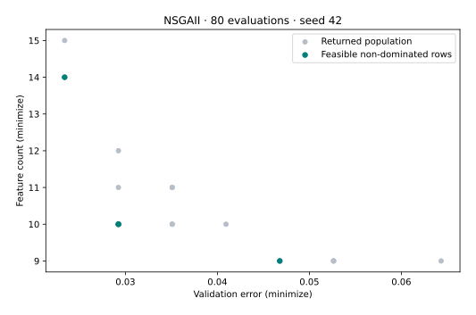

# Feature selection as two objectives

**Goal:** connect decision variables to a practical objective pair, execute the model, and select or interpret a candidate without losing its original row.

Prerequisites: [T02](t02-constrained-problem.md), [T03](t03-pareto-decision.md), and the [coverage setup](coverage-setup.md). The [problem reference](../reference/problems.md) lists the built-in evaluator; the [public protocol](../reference/api/problem-definition.md) explains its metadata.

## Formulate the example

A binary mask selects columns from scikit-learn’s bundled breast-cancer benchmark. The built-in evaluator fits a standardized logistic-regression classifier and minimizes **validation error** and **number of selected features**. The dataset is used as a software benchmark; this experiment provides no clinical validation.

The data split uses `random_state=0`, a validation fraction of 0.3 and stratification. Scaling is fitted on training data. The optimizer seed is 42, independently of the split seed. Repeatedly optimizing against the same split makes its error a validation objective, not an unbiased test estimate.

## Run and inspect

This example uses NumPy, optimizer seed 42 and **80 evaluations**, including the initial population. Feature-selection and model-tuning cases require scikit-learn; plotting adds Matplotlib.

```bash
python feature_selection.py
python feature_selection.py --output feature_selection-local.svg
```

[Download the complete script](../assets/coverage/feature_selection.py).

<!-- tutorial:code -->
??? example "Complete runnable script"

    ```python
    """Verified VAMOS 1.0.1 lesson: feature_selection. See coverage-setup for dependencies."""


    def execute_example(problem, algorithm, config, budget, seed=42, engine="numpy"):
        import numpy as np

        from vamos import OptimizationResult, optimize

        result = optimize(problem, algorithm=algorithm, algorithm_config=config, max_evaluations=budget, seed=seed, engine=engine)
        G = result.data.get("G")
        if getattr(problem, "n_constraints", 0) and G is None:
            raise ValueError("Declared constraints are missing from the returned result.")
        feasible_rows = np.arange(len(result.F)) if G is None else np.flatnonzero(np.all(G <= 0, axis=1))
        if len(feasible_rows):
            feasible = OptimizationResult({"X": result.X[feasible_rows], "F": result.F[feasible_rows]})
            front, local = feasible.front(return_indices=True)
            front_rows = feasible_rows[local]
        else:
            front, front_rows = np.empty((0, problem.n_obj)), np.empty(0, dtype=int)
        print(f"Algorithm: {algorithm}; encoding: {problem.encoding}; backend: {engine}; seed: {seed}")
        print(f"Returned X: {result.X.shape}; F: {result.F.shape}; result mode: population")
        print(f"Feasible rows: {len(feasible_rows)}/{len(result.F)}; feasible non-dominated rows: {len(front)}")
        print(f"Evaluations: {result.data['evaluations']}")
        return {
            "problem": problem,
            "algorithm": algorithm,
            "config": config,
            "result": result,
            "feasible_rows": feasible_rows,
            "front": front,
            "front_rows": front_rows,
        }


    def run_feature_selection(budget=80):
        import numpy as np

        from vamos.algorithms import NSGAIIConfig
        from vamos.problems import FeatureSelectionProblem

        problem = FeatureSelectionProblem(dataset="breast_cancer", test_size=0.3, random_state=0)
        config = (
            NSGAIIConfig.builder()
            .pop_size(16)
            .offspring_size(16)
            .crossover("uniform", prob=0.9)
            .mutation("bitflip", prob=1.0 / problem.n_var)
            .selection("tournament", size=2)
            .result_mode("population")
            .build()
        )
        data = execute_example(problem, "nsgaii", config, budget)
        print("Dataset: breast_cancer; split random_state: 0; validation fraction: 0.3")
        print("Nonempty returned feature masks:", int(np.count_nonzero(data["result"].X.sum(axis=1))))
        print("Error is a repeatedly inspected validation objective, not an unbiased test estimate.")
        return data


    def plot_example(data, output):
        from pathlib import Path

        import matplotlib

        matplotlib.use("Agg")
        import matplotlib.pyplot as plt
        import numpy as np

        output = Path(output)
        if output.exists():
            raise FileExistsError(f"Choose a new figure filename: {output}")
        if output.suffix.lower() != ".svg":
            raise ValueError("Use an .svg output filename.")
        f = data["result"].F
        with plt.rc_context({"svg.hashsalt": "vamos-coverage", "svg.fonttype": "none"}):
            fig = plt.figure(figsize=(7, 4.5), layout="constrained")
            if f.shape[1] == 3:
                ax = fig.add_subplot(projection="3d")
                ax.scatter(*f.T, c="#007f7a", s=22)
                ax.set(xlabel="f1", ylabel="f2", zlabel="f3")
                ax.set_box_aspect((1, 1, 0.85), zoom=0.85)
            else:
                ax = fig.add_subplot()
                ax.scatter(*f.T, c="#b6bec8", s=25, label="Returned population")
                if len(data["front"]):
                    ax.scatter(*data["front"].T, c="#007f7a", s=30, label="Feasible non-dominated rows")
                labels = {
                    "WeldedBeamDesignProblem": ("Cost (minimize)", "Deflection proxy (minimize)"),
                    "FeatureSelectionProblem": ("Validation error (minimize)", "Feature count (minimize)"),
                    "HyperparameterTuningProblem": ("Validation error (minimize)", "Complexity proxy (minimize)"),
                }
                xlabel, ylabel = labels.get(type(data["problem"]).__name__, ("f1 (minimize)", "f2 (minimize)"))
                ax.set(xlabel=xlabel, ylabel=ylabel)
                ax.legend()
            if data["problem"].__class__.__name__ in {"ZDT1", "ZDT1Problem"}:
                x = np.linspace(0, 1, 101)
                ax.plot(x, 1 - np.sqrt(x), "--", c="#7c8795", label="Analytical front")
                ax.legend()
            ax.set_title(f"{data['algorithm'].upper()} · {data['result'].data['evaluations']} evaluations · seed 42")
            fig.savefig(output, metadata={"Date": None}, bbox_inches="tight", pad_inches=0.25)
            plt.close(fig)
        output.write_text("\n".join(line.rstrip() for line in output.read_text(encoding="utf-8").splitlines()) + "\n", encoding="utf-8")


    def lesson_cli(function, default_budget=400):
        import argparse

        parser = argparse.ArgumentParser(description="Run a bounded VAMOS example and optionally plot its actual result.")
        parser.add_argument("--budget", type=int, default=default_budget)
        parser.add_argument("--output", help="New SVG filename; requires Matplotlib")
        args = parser.parse_args()
        data = function(budget=args.budget)
        if args.output:
            plot_example(data, args.output)


    if __name__ == "__main__":
        lesson_cli(run_feature_selection, default_budget=80)
    ```
<!-- /tutorial:code -->

### Recorded output

<!-- tutorial:output -->
```text
Algorithm: nsgaii; encoding: binary; backend: numpy; seed: 42
Returned X: (16, 30); F: (16, 2); result mode: population
Feasible rows: 16/16; feasible non-dominated rows: 4
Evaluations: 80
Dataset: breast_cancer; split random_state: 0; validation fraction: 0.3
Nonempty returned feature masks: 16
Error is a repeatedly inspected validation objective, not an unbiased test estimate.
```
<!-- /tutorial:output -->



*Measured with VAMOS 1.0.1; the [observations and provenance](coverage-setup.md#recorded-evidence) retain the inputs and results.*

## Interpret the result and limits

Each `X` row is a 30-feature mask; `F[:, 1]` gives the selected-feature count for nonempty masks. Recover the mask using the original front row index before reporting a chosen subset. NSGA-II uses population/offspring 16, uniform crossover and bit-flip mutation; this is only a small functional run.

The built-in evaluator penalizes an empty mask with error 1 and the full feature count. Training exceptions also produce error 1, so that value is not by itself a diagnosis of a genuinely poor classifier. For a research application, inspect training failures, use a suitable repeated or nested validation design, and preserve a final test set outside search. The algorithm seed does not establish bitwise reproducibility for every model solver or platform.

## Try one controlled change

State a maximum feature count, select only eligible feasible-front rows, and compare validation errors. If no row meets the limit, report that absence rather than quietly relaxing the preference.

**Next:** preserve the selected run with the [run lifecycle](../guide/run-artifacts.md), or use [T06](t06-fair-study.md) to compare an explicit set of configurations across seeds.
