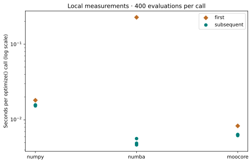

# Measure backend time without hiding initialization

**Goal:** measure a fixed optimization workload and separate first-call costs from subsequent executions. Read [backend roles](../reference/algorithms.md#backends) first. This is a local end-to-end timing example, not a package performance ranking.

The script runs NSGA-II on 10-variable ZDT1 with population 40 and 400 evaluations. Each of NumPy, Numba and MooCore receives one first measured call with seed 42, followed by three fresh runs with seeds 0/1/2. Subsequent backend order rotates. Every call creates fresh optimizer state: **12 calls and 4,800 actual objective evaluations** in the recorded run.

The timer wraps `optimize()`, including its setup and the selected backend’s initialization as reached by that call. It excludes problem construction, plotting, file writes and subsequent HV measurement. The first measured call may encounter an existing disk cache; it is not guaranteed to be a completely cold-machine experiment.

## Run the complete example

Prerequisites: [coverage setup](coverage-setup.md) and [T06–T08](t06-fair-study.md). Download the script below and choose a new output directory. The wrapper refuses an existing directory.

```bash
python performance.py --output performance-example
```

[Download the complete script](../assets/coverage/performance.py).

<!-- tutorial:code -->
??? example "Complete runnable script"

    ```python
    """Verified VAMOS 1.0.1 lesson: performance. See coverage-setup for dependencies."""


    def new_output(output):
        from pathlib import Path

        path = Path(output)
        path.mkdir(parents=True, exist_ok=False)
        return path


    def write_observations(output, data):
        import json

        (output / "observations.json").write_text(json.dumps(data, indent=2, allow_nan=False) + "\n", encoding="utf-8")
        return data


    def run_performance_example(output, budget=400, repeats=3, backends=("numpy", "numba", "moocore")):
        import importlib.metadata
        import os
        import platform
        import statistics
        import time

        from moocore import hypervolume

        from vamos import optimize
        from vamos.algorithms import NSGAIIConfig
        from vamos.problems import ZDT1

        if budget < 40 or repeats < 1 or not backends or len(set(backends)) != len(backends):
            raise ValueError("Use budget >= 40, positive repeats and distinct backends.")
        output = new_output(output)
        config = NSGAIIConfig.default(pop_size=40, n_var=10)
        data = {
            "kind": "performance",
            "budget": budget,
            "repeats": repeats,
            "reference_point": [1.1, 11.0],
            "environment": {
                "python": platform.python_version(),
                "system": platform.system(),
                "release": platform.release(),
                "machine": platform.machine(),
                "processor": platform.processor(),
                "logical_cpus": os.cpu_count(),
                "packages": {p: importlib.metadata.version(p) for p in ("vamos-optimization", "numpy", "scipy", "numba", "moocore")},
                "threads": {
                    k: os.environ.get(k, "unset") for k in ("OMP_NUM_THREADS", "OPENBLAS_NUM_THREADS", "MKL_NUM_THREADS", "NUMBA_NUM_THREADS")
                },
            },
            "rows": [],
        }
        # First measured call in this process is not a guaranteed empty OS/JIT disk cache.
        schedule = [("first", backend, 42) for backend in backends]
        for seed in range(repeats):
            order = backends[seed % len(backends) :] + backends[: seed % len(backends)]
            schedule.extend(("subsequent", backend, seed) for backend in order)
        for phase, backend, seed in schedule:
            problem = ZDT1(n_var=10)
            started = time.perf_counter()
            result = optimize(problem, algorithm="nsgaii", algorithm_config=config, max_evaluations=budget, seed=seed, engine=backend)
            elapsed = time.perf_counter() - started
            data["rows"].append(
                {
                    "phase": phase,
                    "backend": backend,
                    "seed": seed,
                    "seconds": elapsed,
                    "evaluations": int(result.data["evaluations"]),
                    "hv": float(hypervolume(result.front(), ref=data["reference_point"])),
                }
            )
        for backend in backends:
            first = next(r["seconds"] for r in data["rows"] if r["backend"] == backend and r["phase"] == "first")
            samples = [r["seconds"] for r in data["rows"] if r["backend"] == backend and r["phase"] == "subsequent"]
            print(
                f"{backend}: first {first:.6f}s; subsequent median {statistics.median(samples):.6f}s; "
                f"range [{min(samples):.6f}, {max(samples):.6f}]s"
            )
        print(f"Actual evaluations: {sum(r['evaluations'] for r in data['rows'])}; fresh optimizer state for every call.")
        print("Times describe this machine and tiny workload; no universal backend ranking follows.")
        return write_observations(output, data)


    def advanced_cli(function):
        import argparse

        parser = argparse.ArgumentParser(description="Run a bounded workflow in a new output directory.")
        parser.add_argument("--output", required=True)
        args = parser.parse_args()
        function(args.output)


    if __name__ == "__main__":
        advanced_cli(run_performance_example)
    ```
<!-- /tutorial:code -->

### Recorded output

<!-- tutorial:output -->
```text
numpy: first 0.018157s; subsequent median 0.015707s; range [0.015278, 0.015735]s
numba: first 0.226595s; subsequent median 0.004910s; range [0.004663, 0.005652]s
moocore: first 0.008319s; subsequent median 0.006352s; range [0.006193, 0.006411]s
Actual evaluations: 4800; fresh optimizer state for every call.
Times describe this machine and tiny workload; no universal backend ranking follows.
```
<!-- /tutorial:output -->



*Measured with VAMOS 1.0.1; the [observations and provenance](coverage-setup.md#recorded-evidence) retain the inputs and results.*

## Interpret the measurements and limits

The report retains each duration, phase, backend, seed, evaluation count and final HV, plus Python/package versions, operating system, architecture, CPU count and thread environment. Set thread limits **before starting Python** for a controlled comparison, for example in a POSIX shell:

```bash
OMP_NUM_THREADS=1 OPENBLAS_NUM_THREADS=1 MKL_NUM_THREADS=1 NUMBA_NUM_THREADS=1 python performance.py --output timings-one-thread
```

On PowerShell, set those environment variables through `$env:NAME="1"` before the same Python command. Exact dependency versions are in the [setup](coverage-setup.md).

The logarithmic figure shows every timing sample and labels first versus subsequent calls. No backend is silently substituted when an optional backend is unavailable. First-call JIT work, cache state, timer overhead, CPU scheduling, competing workloads and thread settings can dominate this tiny example. Median and range over three subsequent samples are descriptive, not a confidence interval. HV is retained to detect changes in search outcomes; equal budgets alone do not prove identical algorithms or results across numerical implementations.

For a meaningful performance claim, use representative objective costs, larger budgets, repeated isolated processes and controlled hardware. Distinguish objective-evaluation time from optimization overhead. Check quality and exact evaluation counts alongside elapsed time.

## Try one controlled change

Increase the budget to 4,000 in the script and use a new output directory. Keep thread settings and configuration fixed; compare whether initialization still dominates. Do not reuse a previous run’s optimizer state.

**Next:** use [T08](t08-study-report.md) to report a prespecified experiment with its failures, assumptions and evidence. Consult [stability and versioning](../project/stability-and-versioning.md) before depending on Experimental interfaces.
