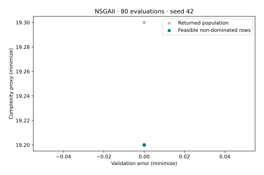

# Model hyperparameters with mixed decisions

**Goal:** connect decision variables to a practical objective pair, execute the model, and select or interpret a candidate without losing its original row.

Prerequisites: [T02](t02-constrained-problem.md), [T03](t03-pareto-decision.md), and the [coverage setup](coverage-setup.md). The [problem reference](../reference/problems.md) lists the built-in evaluator; the [public protocol](../reference/api/problem-definition.md) explains its metadata.

## Formulate the example

This example optimizes a support-vector classifier on scikit-learn’s bundled wine dataset. It is **model hyperparameter optimization**, distinct from [tuning a VAMOS algorithm](tuning-experiment.md).

The four decisions encode `C = exp(4*x[0] - 2)`, `gamma = exp(4*x[1] - 3)`, a kernel category (`rbf`, `linear`, `poly`), and integer polynomial degree 2–5. Mixed crossover and mutation preserve these different domains. The objectives are validation error and `number_of_support_vectors + 0.1 * degree`.

## Run and inspect

This example uses NumPy, optimizer seed 42 and **80 evaluations**, including the initial population. Feature-selection and model-tuning cases require scikit-learn; plotting adds Matplotlib.

```bash
python model_tuning.py
python model_tuning.py --output model_tuning-local.svg
```

[Download the complete script](../assets/coverage/model_tuning.py).

<!-- tutorial:code -->
??? example "Complete runnable script"

    ```python
    """Verified VAMOS 1.0.1 lesson: model_tuning. See coverage-setup for dependencies."""


    def execute_example(problem, algorithm, config, budget, seed=42, engine="numpy"):
        import numpy as np

        from vamos import OptimizationResult, optimize

        result = optimize(problem, algorithm=algorithm, algorithm_config=config, max_evaluations=budget, seed=seed, engine=engine)
        G = result.data.get("G")
        if getattr(problem, "n_constraints", 0) and G is None:
            raise ValueError("Declared constraints are missing from the returned result.")
        feasible_rows = np.arange(len(result.F)) if G is None else np.flatnonzero(np.all(G <= 0, axis=1))
        if len(feasible_rows):
            feasible = OptimizationResult({"X": result.X[feasible_rows], "F": result.F[feasible_rows]})
            front, local = feasible.front(return_indices=True)
            front_rows = feasible_rows[local]
        else:
            front, front_rows = np.empty((0, problem.n_obj)), np.empty(0, dtype=int)
        print(f"Algorithm: {algorithm}; encoding: {problem.encoding}; backend: {engine}; seed: {seed}")
        print(f"Returned X: {result.X.shape}; F: {result.F.shape}; result mode: population")
        print(f"Feasible rows: {len(feasible_rows)}/{len(result.F)}; feasible non-dominated rows: {len(front)}")
        print(f"Evaluations: {result.data['evaluations']}")
        return {
            "problem": problem,
            "algorithm": algorithm,
            "config": config,
            "result": result,
            "feasible_rows": feasible_rows,
            "front": front,
            "front_rows": front_rows,
        }


    def run_model_tuning(budget=80):
        from vamos.algorithms import NSGAIIConfig
        from vamos.problems import HyperparameterTuningProblem

        problem = HyperparameterTuningProblem(dataset="wine", test_size=0.3, random_state=0)
        config = (
            NSGAIIConfig.builder()
            .pop_size(16)
            .offspring_size(16)
            .crossover("mixed", prob=0.9)
            .mutation("mixed", prob=1.0 / problem.n_var)
            .selection("tournament", size=2)
            .result_mode("population")
            .build()
        )
        data = execute_example(problem, "nsgaii", config, budget)
        print("Dataset: wine; split random_state: 0; validation fraction: 0.3")
        print("Decisions: log-scaled C, log-scaled gamma, kernel category, polynomial degree.")
        print("Objectives: validation error; support-vector count + 0.1 * degree.")
        return data


    def plot_example(data, output):
        from pathlib import Path

        import matplotlib

        matplotlib.use("Agg")
        import matplotlib.pyplot as plt
        import numpy as np

        output = Path(output)
        if output.exists():
            raise FileExistsError(f"Choose a new figure filename: {output}")
        if output.suffix.lower() != ".svg":
            raise ValueError("Use an .svg output filename.")
        f = data["result"].F
        with plt.rc_context({"svg.hashsalt": "vamos-coverage", "svg.fonttype": "none"}):
            fig = plt.figure(figsize=(7, 4.5), layout="constrained")
            if f.shape[1] == 3:
                ax = fig.add_subplot(projection="3d")
                ax.scatter(*f.T, c="#007f7a", s=22)
                ax.set(xlabel="f1", ylabel="f2", zlabel="f3")
                ax.set_box_aspect((1, 1, 0.85), zoom=0.85)
            else:
                ax = fig.add_subplot()
                ax.scatter(*f.T, c="#b6bec8", s=25, label="Returned population")
                if len(data["front"]):
                    ax.scatter(*data["front"].T, c="#007f7a", s=30, label="Feasible non-dominated rows")
                labels = {
                    "WeldedBeamDesignProblem": ("Cost (minimize)", "Deflection proxy (minimize)"),
                    "FeatureSelectionProblem": ("Validation error (minimize)", "Feature count (minimize)"),
                    "HyperparameterTuningProblem": ("Validation error (minimize)", "Complexity proxy (minimize)"),
                }
                xlabel, ylabel = labels.get(type(data["problem"]).__name__, ("f1 (minimize)", "f2 (minimize)"))
                ax.set(xlabel=xlabel, ylabel=ylabel)
                ax.legend()
            if data["problem"].__class__.__name__ in {"ZDT1", "ZDT1Problem"}:
                x = np.linspace(0, 1, 101)
                ax.plot(x, 1 - np.sqrt(x), "--", c="#7c8795", label="Analytical front")
                ax.legend()
            ax.set_title(f"{data['algorithm'].upper()} · {data['result'].data['evaluations']} evaluations · seed 42")
            fig.savefig(output, metadata={"Date": None}, bbox_inches="tight", pad_inches=0.25)
            plt.close(fig)
        output.write_text("\n".join(line.rstrip() for line in output.read_text(encoding="utf-8").splitlines()) + "\n", encoding="utf-8")


    def lesson_cli(function, default_budget=400):
        import argparse

        parser = argparse.ArgumentParser(description="Run a bounded VAMOS example and optionally plot its actual result.")
        parser.add_argument("--budget", type=int, default=default_budget)
        parser.add_argument("--output", help="New SVG filename; requires Matplotlib")
        args = parser.parse_args()
        data = function(budget=args.budget)
        if args.output:
            plot_example(data, args.output)


    if __name__ == "__main__":
        lesson_cli(run_model_tuning, default_budget=80)
    ```
<!-- /tutorial:code -->

### Recorded output

<!-- tutorial:output -->
```text
Algorithm: nsgaii; encoding: mixed; backend: numpy; seed: 42
Returned X: (16, 4); F: (16, 2); result mode: population
Feasible rows: 16/16; feasible non-dominated rows: 9
Evaluations: 80
Dataset: wine; split random_state: 0; validation fraction: 0.3
Decisions: log-scaled C, log-scaled gamma, kernel category, polynomial degree.
Objectives: validation error; support-vector count + 0.1 * degree.
```
<!-- /tutorial:output -->



*Measured with VAMOS 1.0.1; the [observations and provenance](coverage-setup.md#recorded-evidence) retain the inputs and results.*

## Interpret the result and limits

The recorded run has zero validation error in every returned row and repeated objective pairs; the visible overlap is real. This does not imply zero error on unseen data.

The complexity objective is a proxy, not measured latency or memory. Its degree term remains in the expression even for kernels that do not use polynomial degree; interpret the model as implemented rather than attaching a universal meaning to the proxy.

The fixed stratified split uses `random_state=0` and validation fraction 0.3; scaling is trained only on the training partition. Population and offspring are 16, and the optimizer seed is 42. Validation error has been inspected repeatedly by search. A lower value here is not a held-out test guarantee. Model-training errors can receive the evaluator’s penalty and need separate investigation in a serious study.

## Try one controlled change

Select a candidate under an explicit complexity limit, decode its decisions using the formulas above, and evaluate the chosen model under a separate validation protocol. Keep the final test data out of the search.

**Next:** preserve the selected run with the [run lifecycle](../guide/run-artifacts.md), or use [T06](t06-fair-study.md) to compare an explicit set of configurations across seeds.
