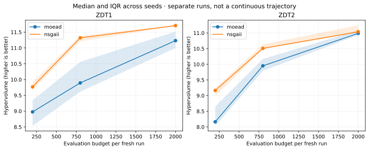
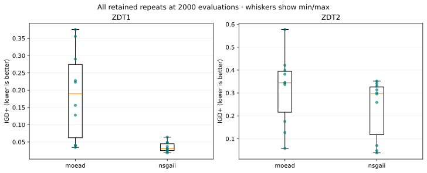

# Recorded study report

Source SHA-256: `dbfed9875afbe1d1697b94b00d3e080fe66a6575b2eb1c3e9a86f27f4a4b3b8e`

All observations come from verified persisted runs. This report does not rerun optimization.

| Problem | Algorithm | Budget | Repeats | HV median [Q1, Q3] ↑ | IGD+ median [Q1, Q3] ↓ |
| --- | --- | ---: | ---: | --- | --- |
| zdt1 | moead | 200 | 10 | 8.976699 [8.530672, 9.343050] | 1.569691 [1.113530, 1.714475] |
| zdt1 | moead | 800 | 10 | 9.893841 [9.616116, 10.558809] | 0.827681 [0.417799, 0.956596] |
| zdt1 | moead | 2000 | 10 | 11.232371 [11.000206, 11.519566] | 0.189720 [0.062229, 0.274339] |
| zdt1 | nsgaii | 200 | 10 | 9.768761 [9.673728, 9.915476] | 1.118603 [0.896094, 1.320738] |
| zdt1 | nsgaii | 800 | 10 | 11.320392 [11.211871, 11.383002] | 0.268171 [0.222940, 0.396848] |
| zdt1 | nsgaii | 2000 | 10 | 11.707686 [11.692251, 11.718976] | 0.030541 [0.025193, 0.044977] |
| zdt2 | moead | 200 | 10 | 8.163663 [8.030817, 8.650843] | 2.720717 [2.318674, 2.756765] |
| zdt2 | moead | 800 | 10 | 9.951560 [9.792049, 10.171434] | 1.239909 [1.029809, 1.305593] |
| zdt2 | moead | 2000 | 10 | 10.988770 [10.932504, 11.087343] | 0.344353 [0.215804, 0.394602] |
| zdt2 | nsgaii | 200 | 10 | 9.165179 [8.981931, 9.233088] | 1.829512 [1.687968, 1.963302] |
| zdt2 | nsgaii | 800 | 10 | 10.509070 [10.486238, 10.640125] | 0.710542 [0.596607, 0.780407] |
| zdt2 | nsgaii | 2000 | 10 | 11.039830 [11.008922, 11.247592] | 0.298105 [0.117587, 0.326099] |

## What these observations show

At 2000 evaluations on **zdt1**, moead: median HV 11.232371, median IGD+ 0.189720 (10 repeats); nsgaii: median HV 11.707686, median IGD+ 0.030541 (10 repeats).

At 2000 evaluations on **zdt2**, moead: median HV 10.988770, median IGD+ 0.344353 (10 repeats); nsgaii: median HV 11.039830, median IGD+ 0.298105 (10 repeats).

Read higher HV and lower IGD+ as better under the declared references. Compare the spreads in the table and plots,
then limit any preference to these problems, settings, budgets and observed repeats; it is not evidence of general superiority.

## Interpretation limits

These are per-problem descriptive observations, not a general algorithm ranking.
Quartiles describe variability; they are not confidence intervals. Shared seed labels do not create paired samples.
The budget comparisons use fresh runs and charge every run in full; no continuous convergence history was recorded.
Only two problems are included. No p-value, significance claim, or algorithm-wide superiority is reported.
Do not average raw HV across different problems. See metrics.csv for each task, selected attempt, run ID and manifest hash.

[Download the observations](../assets/studies/recorded-measurements.json) · [Task metrics](../assets/studies/metrics.csv) · [Grouped summaries](../assets/studies/summary.csv)

Generated from the recorded protocol in [Study setup](study-setup.md#the-recorded-experiment). Follow [T08](t08-study-report.md) to rebuild this report without rerunning optimization.
