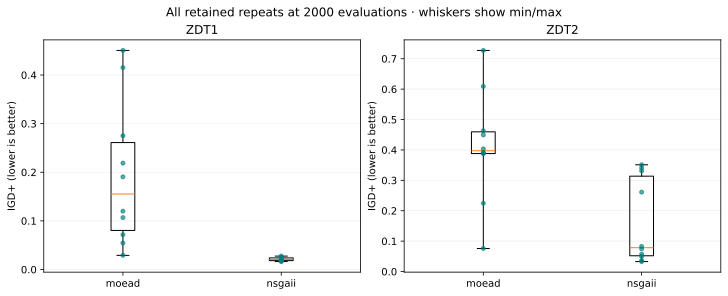

# Recorded study report

Source SHA-256: `09922dd0644a9b53072e4ae492a8abcec334fd8ef8c77f6a1d7b3e1ffc8468aa`

All observations come from verified persisted runs. This report does not rerun optimization.

| Problem | Algorithm | Budget | Repeats | HV median [Q1, Q3] ↑ | IGD+ median [Q1, Q3] ↓ |
| --- | --- | ---: | ---: | --- | --- |
| zdt1 | moead | 200 | 10 | 8.784346 [8.210217, 9.437231] | 1.577471 [1.389195, 1.911534] |
| zdt1 | moead | 800 | 10 | 10.435732 [9.830153, 10.672667] | 0.852780 [0.641639, 1.006810] |
| zdt1 | moead | 2000 | 10 | 11.391416 [11.110845, 11.541522] | 0.155270 [0.080292, 0.261014] |
| zdt1 | nsgaii | 200 | 10 | 9.965693 [9.806668, 10.140251] | 0.950240 [0.918322, 1.071025] |
| zdt1 | nsgaii | 800 | 10 | 11.387910 [11.351752, 11.403016] | 0.221927 [0.201537, 0.243338] |
| zdt1 | nsgaii | 2000 | 10 | 11.727428 [11.720344, 11.730542] | 0.020584 [0.018246, 0.023882] |
| zdt2 | moead | 200 | 10 | 8.643535 [8.091479, 8.810984] | 2.410057 [2.132219, 2.675091] |
| zdt2 | moead | 800 | 10 | 9.681291 [9.380593, 10.001445] | 1.504536 [1.241943, 1.799590] |
| zdt2 | moead | 2000 | 10 | 10.917895 [10.811058, 10.939342] | 0.397227 [0.388124, 0.459442] |
| zdt2 | nsgaii | 200 | 10 | 8.901400 [8.735845, 9.137348] | 2.001699 [1.775835, 2.089834] |
| zdt2 | nsgaii | 800 | 10 | 10.667911 [10.606870, 10.723165] | 0.593753 [0.495340, 0.671978] |
| zdt2 | nsgaii | 2000 | 10 | 11.299353 [11.022738, 11.334468] | 0.078550 [0.051961, 0.313630] |

## What these observations show

At 2000 evaluations on **zdt1**, moead: median HV 11.391416, median IGD+ 0.155270 (10 repeats); nsgaii: median HV 11.727428, median IGD+ 0.020584 (10 repeats).

At 2000 evaluations on **zdt2**, moead: median HV 10.917895, median IGD+ 0.397227 (10 repeats); nsgaii: median HV 11.299353, median IGD+ 0.078550 (10 repeats).

Read higher HV and lower IGD+ as better under the declared references. Compare the spreads in the table and plots,
then limit any preference to these problems, settings, budgets and observed repeats; it is not evidence of general superiority.

## Interpretation limits

These are per-problem descriptive observations, not a general algorithm ranking.
Quartiles describe variability; they are not confidence intervals. Shared seed labels do not create paired samples.
The budget comparisons use fresh runs and charge every run in full; no continuous convergence history was recorded.
Only two problems are included. No p-value, significance claim, or algorithm-wide superiority is reported.
Do not average raw HV across different problems. See metrics.csv for each task, selected attempt, run ID and manifest hash.

[Download the observations](../assets/studies/recorded-measurements.json) · [Task metrics](../assets/studies/metrics.csv) · [Grouped summaries](../assets/studies/summary.csv)

Generated from the recorded protocol in [Study setup](study-setup.md#the-recorded-experiment). Follow [T08](t08-study-report.md) to rebuild this report without rerunning optimization.
