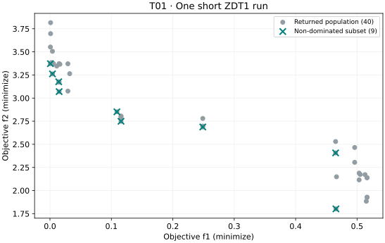

# T01. Your first meaningful result

## Goal

Run one optimization, identify the decisions and objectives it returns, and
explain the difference between a population and its non-dominated subset.
You can stop after this lesson with a meaningful first result.

## Before you start

| Item | This lesson |
| --- | --- |
| Prerequisites | Run a Python script; use the [Minimal Python Track](../guide/minimal-python.md) if needed. |
| Tested package | VAMOS **1.0.1**, Python 3.12; [setup and exact tested dependencies](setup.md). |
| Dependencies | Core package only; no plotting extra is needed to execute the download. |
| Interface status | **Stable** `optimize`, `OptimizationResult`, and `front`; NumPy backend. |
| Run | ZDT1, 30 variables, NSGA-II, population 40, 400 evaluations, seed 42. |

ZDT1 is a built-in two-objective minimization benchmark. This deliberately short
run teaches the workflow; its small budget is not evidence of convergence.

## Complete code

[Download t01-first-result.py](../assets/tutorials/t01-first-result.py) and run:

```bash
python t01-first-result.py
```

The downloadable file and this block are generated from the same maintained
example. The function returns data for inspection; running the file prints the
summary without creating any files.

<!-- tutorial:code -->
```python
"""T01: generated from examples/tutorials/fundamentals.py; VAMOS 1.0.1, core dependencies only."""


def run_t01(max_evaluations=400):
    from vamos import optimize

    result = optimize(
        "zdt1",
        algorithm="nsgaii",
        n_var=30,
        pop_size=40,
        max_evaluations=max_evaluations,
        engine="numpy",
        seed=42,
    )
    front_F, indices = result.front(return_indices=True)
    front_X = result.X[indices]
    print(f"Returned decisions: {result.X.shape}")
    print(f"Returned objectives: {result.F.shape}")
    print(f"Non-dominated objectives: {front_F.shape}")
    print(f"Matching decisions: {front_X.shape}")
    print(f"Evaluations: {result.data['evaluations']}")
    return {"result": result, "front_F": front_F, "front_indices": indices}


if __name__ == "__main__":
    run_t01()
```
<!-- /tutorial:code -->

## Observed result

This is actual output from the installed 1.0.1 wheel in the
[recorded environment](setup.md#tested-environment-and-evidence).

<!-- tutorial:output -->
```text
Returned decisions: (40, 30)
Returned objectives: (40, 2)
Non-dominated objectives: (9, 2)
Matching decisions: (9, 30)
Evaluations: 400
```
<!-- /tutorial:output -->



The figure is generated from the same execution as the printed output. It
shows returned candidates, not the analytical Pareto front or a second run.

## Interpret the result

- Each row of `X` holds 30 decision variables. The same row of `F` contains
  their two objective values: `X[i]` and `F[i]` describe one candidate.
- The **400 evaluations** are the search budget. They are not the number of
  solutions returned. In this NSGA-II configuration the returned set is the
  final population of **40** rows.
- The **nine non-dominated rows** have no other returned row that is at least
  as good in both objectives and strictly better in one. This is a statement
  about the returned candidates, not global optimality.
- `front(return_indices=True)` supplies indices into the current result.
  Applying those indices to `X` keeps decisions and objectives aligned.

These population semantics are specific to this configuration. An external
archive or another algorithm can expose a different result set; consult
[result modes](../guide/understanding-results.md#know-which-set-x-and-f-represent)
when changing them. `front()` also does not establish feasibility for a
constrained problem; that is the next lesson.

## Try one change

At the bottom of the downloaded script, change the call to
`run_t01(max_evaluations=800)` and run it again. Keep the population and seed
fixed. Check that the evaluation count changes while `X` still has 40 rows.
Compare the objective ranges and the number of non-dominated rows.

A larger non-dominated subset alone does not mean better quality. One seed and
two small budgets do not establish convergence or algorithm superiority.

## Next step

Continue with [T02. Solve your own constrained problem](t02-constrained-problem.md).
For exact result methods, use the [Results API](../reference/api/results.md).
The [complete Quickstart](../guide/zero_to_hero.md) remains available when you
are ready to configure, preserve, and organize runs.
