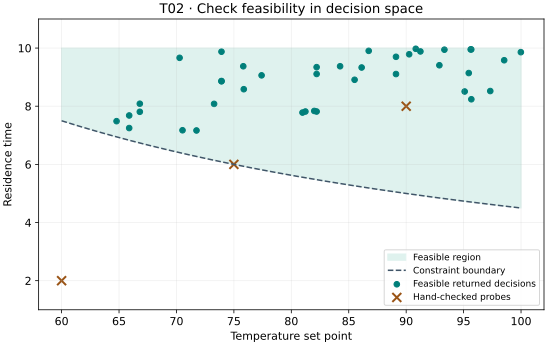

# T02. Solve your own constrained problem

## Goal

Translate a small model into decisions, objectives, bounds, and a constraint;
test the evaluator before searching; then extract feasible trade-offs while
preserving their original row indices.

## Before you start

| Item | This lesson |
| --- | --- |
| Prerequisites | [T01](t01-first-result.md); Python functions and array rows. |
| Tested package | VAMOS **1.0.1**, Python 3.12; [setup and exact tested dependencies](setup.md). |
| Dependencies | Core VAMOS and its NumPy dependency; the download is self-contained. |
| Interface status | **Stable** `make_problem`, `optimize`, `OptimizationResult`, and `front`. |
| Run | NSGA-II, population 40, 400 evaluations, seed 42, NumPy. |

## Define and check the model

This is the teaching surrogate from [Solve your own problem](../guide/custom-problem.md),
not a validated physical process. Both objective scores are minimized.

| Concept | Definition |
| --- | --- |
| Decisions | Temperature set point `T` in `[60, 100]`; residence time `t` in `[2, 10]`. |
| Energy score | `((T - 60) / 40)**2 + 0.25*t/10`. |
| Conversion-shortfall score | `(100 - T)/40 + 2/t`. |
| Requirement | `T*t >= 450`, written as `g = 450 - T*t <= 0`. |

Check three designs by hand: `[60, 2]` is infeasible (`g = 330`), `[75, 6]`
lies on the boundary (`g = 0`), and `[90, 8]` is feasible (`g = -270`).
The middle design's objective scores are approximately `0.290625` and
`0.958333`. These probes test the meaning and sign of the model before the
optimizer spends its budget.

## Complete code

[Download t02-constrained-problem.py](../assets/tutorials/t02-constrained-problem.py)
and run it independently; it does not import T01 or require a repository clone.

```bash
python t02-constrained-problem.py
```

<!-- tutorial:code -->
```python
"""T02: generated from examples/tutorials/fundamentals.py; VAMOS 1.0.1, core dependencies only."""


def process_objectives(x):
    temperature, residence_time = x
    energy = ((temperature - 60.0) / 40.0) ** 2 + 0.25 * residence_time / 10.0
    shortfall = (100.0 - temperature) / 40.0 + 2.0 / residence_time
    return [energy, shortfall]


def process_constraints(x):
    temperature, residence_time = x
    return [450.0 - temperature * residence_time]


def solve_process(max_evaluations=400):
    import numpy as np

    from vamos import OptimizationResult, make_problem, optimize

    problem = make_problem(
        process_objectives,
        n_var=2,
        n_obj=2,
        bounds=[(60.0, 100.0), (2.0, 10.0)],
        encoding="real",
        constraints=process_constraints,
        n_constraints=1,
        name="process_design_surrogate",
    )
    result = optimize(
        problem,
        algorithm="nsgaii",
        pop_size=40,
        max_evaluations=max_evaluations,
        engine="numpy",
        seed=42,
    )
    # Recheck the original requirement, then keep all arrays aligned.
    G = np.array([process_constraints(x) for x in result.X])
    feasible_rows = np.flatnonzero(np.all(G <= 0.0, axis=1))
    if len(feasible_rows) == 0:
        raise ValueError("No feasible candidates: revisit the model or budget.")
    feasible = OptimizationResult(
        {
            "X": result.X[feasible_rows],
            "F": result.F[feasible_rows],
            "G": G[feasible_rows],
        }
    )
    front_F, local_indices = feasible.front(return_indices=True)
    return {
        "result": result,
        "G": G,
        "feasible_rows": feasible_rows,
        "feasible": feasible,
        "front_F": front_F,
        "front_indices": feasible_rows[local_indices],
    }


def run_t02(max_evaluations=400):
    probes = ([60.0, 2.0], [75.0, 6.0], [90.0, 8.0])
    for x in probes:
        f = process_objectives(x)
        g = process_constraints(x)[0]
        print(f"Check {x}: F=({f[0]:.6f}, {f[1]:.6f}), g={g:.1f}")
    data = solve_process(max_evaluations)
    result = data["result"]
    print(f"Feasible returned rows: {len(data['feasible_rows'])}/{len(result.F)}")
    print(f"Feasible non-dominated rows: {len(data['front_F'])}")
    print(f"Evaluations: {result.data['evaluations']}")
    return data


if __name__ == "__main__":
    run_t02()
```
<!-- /tutorial:code -->

## Observed result

Actual output from the [recorded wheel environment](setup.md#tested-environment-and-evidence):

<!-- tutorial:output -->
```text
Check [60.0, 2.0]: F=(0.050000, 2.000000), g=330.0
Check [75.0, 6.0]: F=(0.290625, 0.958333), g=0.0
Check [90.0, 8.0]: F=(0.762500, 0.500000), g=-270.0
Feasible returned rows: 40/40
Feasible non-dominated rows: 40
Evaluations: 400
```
<!-- /tutorial:output -->



The teal markers are optimized decisions from this run. The brown crosses are
the three hand-picked probes, not additional optimization results. The shaded
region and dashed boundary come from the stated constraint equation.

## Interpret the result

All 40 returned rows happen to be feasible and non-dominated in this execution.
That outcome is not a guarantee for a different model, seed, or budget. The
code re-evaluates the original requirement and filters infeasible rows before
Pareto analysis. If none are feasible, it stops with a clear error.

`OptimizationResult` here wraps an explicitly filtered in-memory view. It does
not launch another search or create a persisted run. The `feasible_rows` array
maps that view back to the original result; applying `local_indices` to it
produces `front_indices` in the original row numbering. Thus the selected
`X`, `F`, and `G` rows still describe the same candidates.

`result.front()` on its own only Pareto-filters objectives. Neither
non-dominance nor a hypervolume score proves that a constraint is satisfied.
For numerical equality constraints, define a scientific tolerance deliberately;
this example uses the exact inequality `g <= 0`.

## Try one change

Change `450.0` to `600.0` inside `process_constraints`, then run the script.
First predict the new signs for the three probes: `480`, `150`, and `-120`.
Check those printed values before interpreting any optimized decisions.

The feasible region has changed, so this is a **different problem**. Do not
interpret its objective scores as an algorithm improvement over the original
problem. A short run can now return fewer feasible candidates or none.

## Next step

Continue with [T03. From a Pareto set to a decision](t03-pareto-decision.md).
Use the [full modeling guide](../guide/custom-problem.md) for vectorization,
other encodings, simulator boundaries, and common mistakes, or the
[constraint reference](../reference/constraints.md) for exact conventions.
