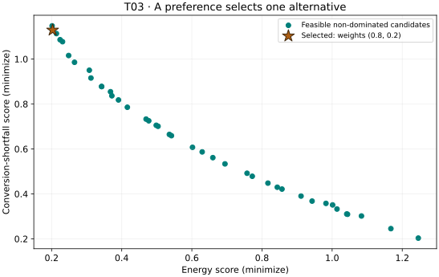

# T03. From a Pareto set to a decision

## Goal

Choose one feasible alternative using an explicit preference rule, recover
its decision variables, and explain how scaling and preferences affect the
choice without changing the optimization problem.

## Before you start

| Item | This lesson |
| --- | --- |
| Prerequisites | [T02](t02-constrained-problem.md); feasibility, non-dominance, and aligned rows. |
| Tested package | VAMOS **1.0.1**, Python 3.12; [setup and exact tested dependencies](setup.md). |
| Dependencies | Core VAMOS and NumPy only; no experimental decision helper is required. |
| Interface status | **Stable** optimization and result facades; the preference calculation is ordinary NumPy code. |
| Run | The same T02 model, NSGA-II, population 40, 400 evaluations, seed 42, NumPy. |

## State a preference before selecting

Pareto dominance removes candidates dominated by another feasible candidate;
it does not identify a universally best trade-off. Here we prefer a lower
energy score, while still considering conversion shortfall.

For each objective, subtract its minimum over the feasible non-dominated
candidates and divide by its observed range. A constant objective gets zero
normalized variation. Then minimize:

```text
score = 0.8 * normalized_energy + 0.2 * normalized_shortfall
```

The weights act on **observed normalized ranges**, not physical units or
percentages of process benefit. If the candidate set changes, those ranges
can change too. For decisions across repeated studies, consider fixed,
domain-justified scales and report them explicitly.

## Complete code

[Download t03-pareto-decision.py](../assets/tutorials/t03-pareto-decision.py).
It includes the same model and feasibility workflow as T02, generated from
their shared source, so it runs on its own:

```bash
python t03-pareto-decision.py
```

<!-- tutorial:code -->
```python
"""T03: generated from examples/tutorials/fundamentals.py; VAMOS 1.0.1, core dependencies only."""


def process_objectives(x):
    temperature, residence_time = x
    energy = ((temperature - 60.0) / 40.0) ** 2 + 0.25 * residence_time / 10.0
    shortfall = (100.0 - temperature) / 40.0 + 2.0 / residence_time
    return [energy, shortfall]


def process_constraints(x):
    temperature, residence_time = x
    return [450.0 - temperature * residence_time]


def solve_process(max_evaluations=400):
    import numpy as np

    from vamos import OptimizationResult, make_problem, optimize

    problem = make_problem(
        process_objectives,
        n_var=2,
        n_obj=2,
        bounds=[(60.0, 100.0), (2.0, 10.0)],
        encoding="real",
        constraints=process_constraints,
        n_constraints=1,
        name="process_design_surrogate",
    )
    result = optimize(
        problem,
        algorithm="nsgaii",
        pop_size=40,
        max_evaluations=max_evaluations,
        engine="numpy",
        seed=42,
    )
    # Recheck the original requirement, then keep all arrays aligned.
    G = np.array([process_constraints(x) for x in result.X])
    feasible_rows = np.flatnonzero(np.all(G <= 0.0, axis=1))
    if len(feasible_rows) == 0:
        raise ValueError("No feasible candidates: revisit the model or budget.")
    feasible = OptimizationResult(
        {
            "X": result.X[feasible_rows],
            "F": result.F[feasible_rows],
            "G": G[feasible_rows],
        }
    )
    front_F, local_indices = feasible.front(return_indices=True)
    return {
        "result": result,
        "G": G,
        "feasible_rows": feasible_rows,
        "feasible": feasible,
        "front_F": front_F,
        "front_indices": feasible_rows[local_indices],
    }


def run_t03(weights=(0.8, 0.2), max_evaluations=400):
    import numpy as np

    data = solve_process(max_evaluations)
    front_F = data["front_F"]
    # Normalize over this feasible non-dominated candidate set only.
    low = front_F.min(axis=0)
    span = np.ptp(front_F, axis=0)
    scaled = (front_F - low) / np.where(span > 0.0, span, 1.0)
    weights = np.asarray(weights, dtype=float)
    if weights.shape != (2,) or not np.isfinite(weights).all() or np.any(weights < 0) or weights.sum() <= 0:
        raise ValueError("Use two finite, non-negative weights with a positive sum.")
    weights = weights / weights.sum()
    scores = scaled @ weights
    position = int(np.argmin(scores))
    row = int(data["front_indices"][position])
    result = data["result"]
    x, f, g = result.X[row], result.F[row], data["G"][row, 0]
    print(f"Feasible non-dominated candidates: {len(front_F)}")
    print(f"Weights (energy, shortfall): {weights.tolist()}")
    print(f"Selected original row: {row}")
    print(f"Decision (temperature, time): ({x[0]:.6f}, {x[1]:.6f})")
    print(f"Objectives (energy, shortfall): ({f[0]:.6f}, {f[1]:.6f})")
    print(f"Constraint g: {g:.6f}")
    print(f"Normalized weighted score: {scores[position]:.6f}")
    data.update({"selected_row": row, "weights": weights, "scores": scores})
    return data


if __name__ == "__main__":
    run_t03()
```
<!-- /tutorial:code -->

## Observed result

Actual output from the [recorded wheel environment](setup.md#tested-environment-and-evidence):

<!-- tutorial:output -->
```text
Feasible non-dominated candidates: 40
Weights (energy, shortfall): [0.8, 0.2]
Selected original row: 39
Decision (temperature, time): (65.884430, 7.249734)
Objectives (energy, shortfall): (0.202885, 1.128761)
Constraint g: -27.644581
Normalized weighted score: 0.197111
```
<!-- /tutorial:output -->



The star identifies a real row of the same candidate set. Its original row
index is reported so the decision vector, objective values, and constraint
value can be checked together.

## Interpret the decision

The selected temperature is approximately **65.884430** and residence time
**7.249734**. Its constraint value is negative, so it satisfies the modeled
requirement. Re-evaluating `process_objectives(x)` reproduces its two objective
scores; re-evaluating `process_constraints(x)` verifies feasibility.

This is the minimum of the chosen weighted score among the returned feasible
non-dominated candidates. It is not a certificate of the globally best process
design. If several rows tie, `argmin` returns the first one in the current
order; it does not prove that the decision is unique.

The Stable `best("balanced_sum")` method applies an equal-weight normalized
sum to a result's non-dominated rows. It is another declared preference rule,
not an automatic feasibility check. Apply it to a feasible view when using a
constrained result; see the [Results API](../reference/api/results.md).

## Try one change

At the bottom of the script, call `run_t03(weights=(0.2, 0.8))` and rerun it.
Keep the model, population, budget, and seed fixed. This gives conversion
shortfall more weight while evaluating the same deterministic candidate set
in the recorded environment.

Compare both selected `X` and `F` rows and verify that both constraint values
are non-positive. A changed selection demonstrates a changed preference;
it does not show an improvement in the optimizer. For a real decision, agree
on scales and preferences with the decision maker before inspecting a favored
alternative, and examine sensitivity to plausible alternatives.

## Next step

You can now run, interpret, model, and select. Continue to
[Run a reproducible study](../guide/studies.md) to plan multiple problems,
algorithms, and seeds, or [save and verify a run](../guide/run-artifacts.md).
Return to [Tutorials](index.md) to choose an algorithm lesson.
