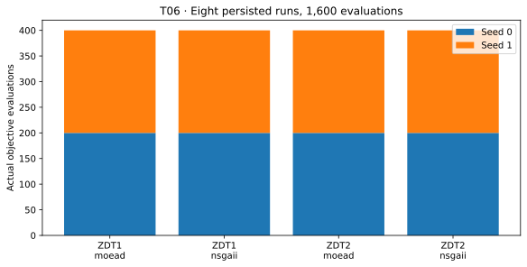

# T06. Run a fair comparative study

## Goal

Turn a comparison question into an explicit, costed plan; execute it once;
and inspect the durable evidence before interpreting any objective values.

## Before you start

| Item | This lesson |
| --- | --- |
| Prerequisites | [T01](t01-first-result.md); population, objectives, evaluations; Python scripts and directories |
| Tested package | VAMOS **1.0.1**, Python 3.12; [setup and downloads](study-setup.md) |
| Dependencies/status | Core VAMOS; **Stable** `StudySpec`, `plan_study`, `create_study`, inspect/summary lifecycle |
| Small run | Two problems × two algorithms × two explicit seeds; population 20; 200 evaluations per task; NumPy |

## Design the comparison before running it

Ask: **what quality do these two configurations return on ZDT1 and ZDT2 under
the same evaluation budget?** Fix dimensions, population, backend, seed list,
failure policy, indicators, and aggregation before examining results.

The [two protocols](study-setup.md#the-recorded-experiment) distinguish the
eight-task functional example from the 120-task recorded experiment. Neither
is a tuning competition. VAMOS freezes resolved algorithm settings in the plan;
a common population is a teaching choice, not a universal fairness rule.
For a publication, also justify configuration/tuning effort, instance selection,
replication, computational resources, and an analysis plan.

An evaluation budget measures calls to the problem evaluator. It does not
equalize runtime, memory, or tuning expense. Using the same seed labels makes
the schedule explicit; different algorithms can consume randomness differently,
so labels alone do not establish paired samples.

## Complete code

Download [t06-fair-study.py](../assets/studies/t06-fair-study.py). First inspect
the plan; the destination must be new:

```bash
python t06-fair-study.py --output results/tutorial-study
```

The plan-only call creates no directory and spends no evaluations. Then execute:

```bash
python t06-fair-study.py --output results/tutorial-study --run
```

<!-- tutorial:code -->
??? example "Complete runnable script"

    ```python
    """T06: generated from examples/tutorials/study_workflow.py; see study-setup for dependencies."""


    def study_spec(profile="smoke", budget=200):
        from vamos import StudySpec

        if profile not in {"smoke", "recorded"}:
            raise ValueError("Choose smoke or recorded.")
        population, repeats = (20, 2) if profile == "smoke" else (40, 10)
        if budget < population or budget % population:
            raise ValueError("Use a budget at least one population and divisible by it.")
        return StudySpec(
            problems=["zdt1", "zdt2"],
            algorithms=["nsgaii", "moead"],
            seeds=list(range(repeats)),
            max_evaluations=budget,
            pop_size=population,
            n_var=10,
            engine="numpy",
            eval_strategy="serial",
            on_error="continue",
            max_attempts_per_task=2,
        )


    def plan_or_execute_study(output, profile="smoke", budget=200, execute=False):
        from pathlib import Path

        from vamos import create_study, plan_study

        output = Path(output)
        if output.exists():
            raise FileExistsError(f"Choose a new study directory: {output}")
        spec = study_spec(profile, budget)
        plan = plan_study(spec, output=output)
        if plan.status != "ready":
            raise ValueError(f"Plan is not ready: {plan.errors}")
        print(f"Planned tasks: {plan.task_count}")
        print(f"Planned evaluations (first attempts): {plan.total_evaluation_budget}")
        if not execute:
            print("Plan only: no directory created and no optimization executed.")
            return plan
        study = create_study(spec, output=output)
        if study.plan_id != plan.plan_id:
            raise RuntimeError("Created plan differs from the reviewed plan.")
        completed = study.run()
        report = completed.inspect()
        print(f"Study state: {report.state}")
        print(f"Succeeded tasks: {report.counts['succeeded']}/{plan.task_count}")
        print(f"Verified run metadata: {report.verified_run_count}")
        print(f"Inspection issues: {len(report.issues)}")
        return completed


    def main_t06(argv=None):
        import argparse

        parser = argparse.ArgumentParser(description="Plan, then optionally execute a small durable study.")
        parser.add_argument("--output", required=True)
        parser.add_argument("--profile", choices=("smoke", "recorded"), default="smoke")
        parser.add_argument("--budget", type=int, default=200)
        parser.add_argument("--run", action="store_true", help="Execute after checking the plan")
        args = parser.parse_args(argv)
        plan_or_execute_study(args.output, args.profile, args.budget, execute=args.run)


    if __name__ == "__main__":
        main_t06()
    ```
<!-- /tutorial:code -->

## Observed result

Actual output of the small workflow from the installed wheel:

<!-- tutorial:output -->
```text
Planned tasks: 8
Planned evaluations (first attempts): 1600
Study state: completed
Succeeded tasks: 8/8
Verified run metadata: 8
Inspection issues: 0
```
<!-- /tutorial:output -->



Each colored segment is the actual evaluation count from one saved run. The
four groups contain two seeds each and sum to the planned 1,600 evaluations.

The canonical [study guide](../guide/studies.md#5-trace-every-summary-row-to-its-run)
shows the summary fields. Every row connects the experimental factors to its
`task_id`, selected attempt, `selected_run_id`, and `run_manifest_path`.

## Interpret operational success

The state means the planned work completed and its run metadata can be checked.
It does not mean the search converged or the design has sufficient statistical
power. T07 will verify numerical bundles before computing quality.

`on_error="continue"` preserves failures and attempts remaining tasks. It does
not convert failure into success or substitute another seed. No retry happens
automatically here. Inspect the cause, use the explicit bounded retry/resume
workflow when appropriate, and retain the selected-attempt provenance.
With at most two attempts per task, retrying all tasks could double the planned
evaluation allowance; record actual consumption rather than hiding retries.

VAMOS 1.0.1 permits a single mutating owner per study and executes tasks
sequentially. Never run, resume, or retry the same directory concurrently.

## Try one change

Plan with `--budget 400` and a new output directory. The task count remains
eight and the first-attempt budget becomes 3,200. Planning still performs no
optimization. To compare budgets, execute both plans and pass both directories
to T07. Count both runs in the total cost; this is not an interrupted run being
resumed.

## Next step

[T07. Measure quality and progress with budget](t07-quality-and-budget.md)
loads the saved runs. For lifecycle details and incident recovery, use
[Run a reproducible study](../guide/studies.md).
