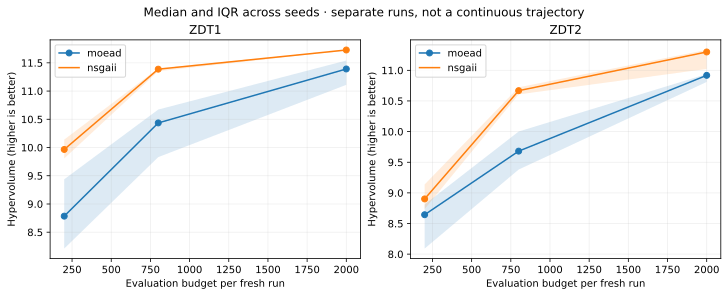

# T07. Measure quality and progress with budget

## Goal

Compute indicators from verified saved runs, explain their direction and
reference choices, and distinguish observed budget sensitivity from a claim
of convergence.

## Before you start

| Item | This lesson |
| --- | --- |
| Prerequisites | A saved [T06 study](t06-fair-study.md); non-dominance and feasibility from [T02](t02-constrained-problem.md) |
| Tested environment | VAMOS **1.0.1**, MooCore **0.3.2**, Python 3.12; [dependency recipe](study-setup.md) |
| Interface status | **Stable** study/result loading and `verify_run`; MooCore is an optional third-party indicator API |
| Work | Load and measure; **no optimization executes** |

## Fix the measurement rule

All objectives are minimized and use their original units. Each run contributes
its returned population's non-dominated subset. These two benchmarks are
unconstrained; for other models, establish feasibility first and apply the same
mask to the aligned arrays. Non-dominance alone does not prove feasibility.

| Indicator | Direction | Frozen reference | Meaning and limits |
| --- | --- | --- | --- |
| Hypervolume (HV) | Higher is better | `[1.1, 11.0]`, worse than ZDT1/ZDT2 objective bounds on their box | Dominated volume inside a fixed region; changing the reference changes the measurement |
| IGD+ | Lower is better | 201 analytical-front points, uniformly spaced in f1 on `[0,1]` | Reference-relative distance; sampling density and scale affect the value |

ZDT1 has `f2 = 1 - sqrt(f1)` on its analytical front; ZDT2 has
`f2 = 1 - f1**2`. The same sampling rule is applied separately to each problem.
No per-run rescaling is used, and fronts from different problems are never
pooled. The script rejects non-finite data and points outside the declared HV
reference box instead of silently changing the reference.

MooCore supplies the actual indicator implementations; see its
[hypervolume](https://multi-objective.github.io/moocore/python/reference/generated/moocore.hypervolume.html)
and [IGD+](https://multi-objective.github.io/moocore/python/reference/generated/moocore.igd_plus.html)
documentation. The download is tested against the pinned version, independently
of future documentation updates.

## Complete code

Download [t07-quality-and-budget.py](../assets/studies/t07-quality-and-budget.py).
Measure the saved small study into a new directory:

```bash
python t07-quality-and-budget.py --studies results/tutorial-study --output results/tutorial-metrics
```

<!-- tutorial:code -->
??? example "Complete runnable script"

    ```python
    """T07: generated from examples/tutorials/study_workflow.py; see study-setup for dependencies."""


    def metric_policy():
        return {
            "objectives": "minimize both; original units; no per-run normalization",
            "hv_reference": [1.1, 11.0],
            "igd_plus_reference": "201 analytical points, f1 uniformly spaced on [0,1]",
            "zdt1_f2": "1 - sqrt(f1)",
            "zdt2_f2": "1 - f1**2",
            "aggregation": "median and linear-interpolation quartiles within problem/algorithm/budget",
            "budget_axis": "separate fresh studies; not checkpoints or a continuous trajectory",
        }


    def measure_front(problem, front):
        import numpy as np
        from moocore import hypervolume, igd_plus

        values = np.asarray(front, dtype=float)
        if values.ndim != 2 or values.shape[1] != 2 or not len(values) or not np.isfinite(values).all():
            raise ValueError("Expected a nonempty finite two-objective front.")
        if problem not in {"zdt1", "zdt2"}:
            raise ValueError("This tutorial defines references only for zdt1 and zdt2.")
        reference_point = np.array(metric_policy()["hv_reference"])
        if np.any(values >= reference_point):
            raise ValueError("A point lies outside the declared HV reference box; review the protocol.")
        x = np.linspace(0.0, 1.0, 201)
        y = 1.0 - np.sqrt(x) if problem == "zdt1" else 1.0 - x**2
        reference_front = np.column_stack([x, y])
        return {
            "hv": float(hypervolume(values, ref=reference_point)),
            "igd_plus": float(igd_plus(values, ref=reference_front)),
        }


    def measure_studies(study_paths, output):
        import hashlib
        import importlib.metadata
        import json
        import platform
        from pathlib import Path

        from vamos import load_result, load_study, verify_run

        output = Path(output)
        if output.exists():
            raise FileExistsError(f"Choose a new measurement directory: {output}")
        dataset = {
            "schema": "vamos.documentation.study-measurements.v1",
            "purpose": "Derived teaching observations, not a StudyManifest or RunManifest",
            "policy": metric_policy(),
            "python": platform.python_version(),
            "packages": {name: importlib.metadata.version(name) for name in ("vamos-optimization", "numpy", "scipy", "joblib", "moocore")},
            "studies": [],
            "rows": [],
        }
        common_design, budgets = None, set()
        for study_path in study_paths:
            study = load_study(study_path)
            report, summary = study.inspect(), study.summarize()
            intent = study.spec.as_intent_dict()
            budget = intent["run_defaults"].pop("max_evaluations")
            if common_design is None:
                common_design = intent
            if intent != common_design or budget in budgets:
                raise ValueError("Compare the same design at distinct budgets; do not pool incompatible or duplicate studies.")
            budgets.add(budget)
            if tuple(study.spec.problems) != ("zdt1", "zdt2") or study.spec.n_var != 10:
                raise ValueError("This teaching measurement protocol requires ZDT1/ZDT2 with 10 variables.")
            dataset["studies"].append(
                {
                    "study_id": study.study_id,
                    "plan_id": study.plan_id,
                    "budget": budget,
                    "state": report.state,
                    "task_count": len(summary.rows),
                    "root_manifest_sha256": summary.root_manifest_sha256,
                    "issues": [issue.as_dict() for issue in report.issues],
                    "intent": study.spec.as_intent_dict(),
                }
            )
            for row in summary.rows:
                record = row.as_dict()
                record.pop("metrics")
                record.update(
                    {
                        "problem": row.problem_id.split(":", 1)[1].split("@", 1)[0],
                        "algorithm": row.algorithm_id.split(":", 1)[1].split("@", 1)[0],
                        "hv": None,
                        "igd_plus": None,
                        "front": None,
                    }
                )
                if row.state == "succeeded" and row.run_manifest_path is not None:
                    run_path = study.root / Path(row.run_manifest_path).parent
                    verified = verify_run(run_path)
                    if verified.run_id != row.selected_run_id or verified.numerical_bundle_safety != "valid":
                        raise ValueError("Numerical run evidence does not match the study summary.")
                    result = load_result(run_path)
                    front = result.front()
                    record["front"] = front.tolist()
                    record["front_sha256"] = hashlib.sha256(json.dumps(record["front"], separators=(",", ":")).encode()).hexdigest()
                    record.update(measure_front(record["problem"], front))
                dataset["rows"].append(record)
        if not dataset["studies"]:
            raise ValueError("Supply at least one persisted study.")
        output.mkdir(parents=True, exist_ok=False)
        (output / "measurements.json").write_text(json.dumps(dataset, indent=2, allow_nan=False) + "\n", encoding="utf-8")
        measured = sum(row["hv"] is not None for row in dataset["rows"])
        print(f"Persisted studies: {len(dataset['studies'])}")
        print(f"Planned rows retained: {len(dataset['rows'])}")
        print(f"Measured successful rows: {measured}")
        print(f"Unavailable rows (not zero-filled): {len(dataset['rows']) - measured}")
        print("HV: higher is better; IGD+: lower is better. References fixed before comparison.")
        return dataset


    def main_t07(argv=None):
        import argparse

        parser = argparse.ArgumentParser(description="Measure verified stored runs; no optimization is executed.")
        parser.add_argument("--studies", nargs="+", required=True)
        parser.add_argument("--output", required=True)
        args = parser.parse_args(argv)
        measure_studies(args.studies, args.output)


    if __name__ == "__main__":
        main_t07()
    ```
<!-- /tutorial:code -->

## Observed result

Actual output for the eight-task small workflow:

<!-- tutorial:output -->
```text
Persisted studies: 1
Planned rows retained: 8
Measured successful rows: 8
Unavailable rows (not zero-filled): 0
HV: higher is better; IGD+: lower is better. References fixed before comparison.
```
<!-- /tutorial:output -->

`measurements.json` retains **every planned row**. Failed or unfinished rows
have unavailable metrics, not zero values and not silently deleted observations.
The successful rows retain their non-dominated objective vectors and original
task/attempt/run identifiers. `verify_run` checks the numerical artifacts;
loading and verification do not rerun the optimizer.

## Read progress honestly

The figure below comes from the **separate recorded experiment**: 10 seeds,
population 40, budgets 200/800/2,000, and 120 persisted runs. Lines join median HV
values; shaded regions are interquartile ranges across seeds, not confidence
intervals. Each panel is one problem.



These are **fresh runs at each budget**. A line between budgets is a visual
comparison, not a generation-by-generation trajectory. The durable study API
used here does not record that trajectory. The total cost is 120,000 evaluations,
including every restart, rather than only the largest budget.

Better HV at a larger budget is an observation under this protocol. A plateau
does not prove convergence, and the final population need not improve
monotonically as a set. Claims about convergence require a separately designed
trace/stopping study and an appropriate reference or bound.

## When the true front is unknown

HV needs a defensible fixed reference point, not a known true front. Define
objective directions, units/scaling, and the reference policy before comparison;
report how many points lie outside its box. Do not choose a different reference
for each algorithm or seed.

IGD+ needs a reference **set**. An independently collected reference or an
explicitly frozen pooled feasible non-dominated set can be useful, but an
empirical set is not the true Pareto front. Record its contributors, hash,
sampling and coverage limitations. Rebuild all affected indicator values if
the reference changes; never mix scores computed against different references.
This download intentionally supports only the two stated analytical references.

## Try one change

After executing the 400-evaluation variant from T06, supply both study paths to
`--studies`. The measurement retains 16 rows, grouped by their original budget.
Changing a budget must not silently change dimensions, configurations, population,
backend, or seed schedule; incompatible designs and duplicate budgets are rejected.

## Next step

[T08. Turn study results into a report](t08-study-report.md) produces tables,
figures and a provenance-preserving CSV. The [recorded observations](../assets/studies/recorded-measurements.json)
are available if you want to explore reporting without running the larger study.
