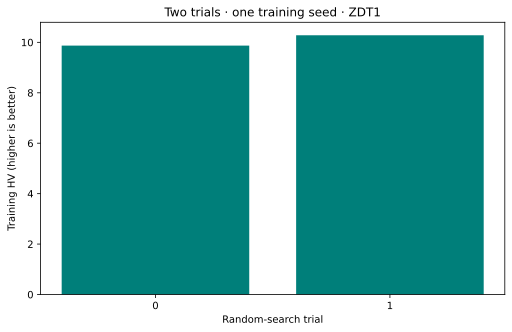

# An experimental tuning run

**Goal:** run a bounded algorithm-configuration search and distinguish training, validation and test seeds. This workflow uses the **Experimental** `vamos tune` CLI; it does not establish a stable programmatic tuner API. Read the [canonical tuning guide](../topics/tuning.md) for the exact flags and backend behavior.

The protocol searches NSGA-II on one 10-variable ZDT1 instance with random search, two candidate trials and 400 evaluations per run. It maximizes HV with fixed reference `[1.1, 11]` in original objective units. The aggregate is median, training seed is 7, validation seeds are 101/102 and test seeds are 201/202. No statistical finisher is enabled.

`--pop-size 20` is the CLI fallback, **not a fixed search-space population**: sampled candidates can choose different sizes. Candidate parameter names such as `offspring_ratio` belong to the tuner’s search space; do not pass `best_config_raw.json` directly to `NSGAIIConfig` as though it were a resolved algorithm configuration. The CLI translates active parameters.

## Run the complete example

Prerequisites: [coverage setup](coverage-setup.md) and [T06–T08](t06-fair-study.md). Download the script below and choose a new output directory. The wrapper refuses an existing directory.

```bash
python tuning.py --output tuning-example
```

[Download the complete script](../assets/coverage/tuning.py).

<!-- tutorial:code -->
??? example "Complete runnable script"

    ```python
    """Verified VAMOS 1.0.1 lesson: tuning. See coverage-setup for dependencies."""


    def new_output(output):
        from pathlib import Path

        path = Path(output)
        path.mkdir(parents=True, exist_ok=False)
        return path


    def write_observations(output, data):
        import json

        (output / "observations.json").write_text(json.dumps(data, indent=2, allow_nan=False) + "\n", encoding="utf-8")
        return data


    def run_tuning_example(output):
        import csv
        import json
        import os
        import subprocess
        import sysconfig
        from pathlib import Path

        output = new_output(output)
        command = [
            str(Path(sysconfig.get_path("scripts")) / ("vamos.exe" if os.name == "nt" else "vamos")),
            "tune",
            "--algorithm",
            "nsgaii",
            "--problem",
            "zdt1",
            "--backend",
            "random",
            "--budget",
            "400",
            "--tune-budget",
            "2",
            "--pop-size",
            "20",
            "--seed",
            "7",
            "--n-seeds",
            "1",
            "--n-jobs",
            "1",
            "--n-var",
            "10",
            "--ref-point",
            "1.1,11",
            "--aggregate-mode",
            "median",
            "--split-seed",
            "42",
            "--run-validation",
            "--run-test",
            "--validation-seeds",
            "101,102",
            "--test-seeds",
            "201,202",
            "--validation-topk",
            "1",
            "--no-run-statistical-finisher",
            "--output-dir",
            str(output),
            "--name",
            "training",
        ]
        # The CLI remains Experimental; the wrapper preserves its original artifacts.
        with (output / "console.txt").open("w", encoding="utf-8") as log:
            subprocess.run(command, stdout=log, stderr=subprocess.STDOUT, check=True)
        root = output / "training"
        summary = json.loads((root / "tuning_summary.json").read_text(encoding="utf-8"))
        history = json.loads((root / "tuning_history.json").read_text(encoding="utf-8"))
        splits = json.loads((root / "split_seeds.json").read_text(encoding="utf-8"))
        stages = {}
        for stage in ("validation", "test"):
            with (root / f"{stage}_metrics.csv").open(encoding="utf-8", newline="") as stream:
                stages[stage] = [
                    {key: row[key] for key in ("score_agg", "rows_total", "rows_ok", "fail_rate")} for row in csv.DictReader(stream)
                ]
        data = {
            "kind": "tuning",
            "status": "Experimental",
            "budget_per_run": 400,
            "reference_point": [1.1, 11.0],
            "seeds": splits,
            "backend": summary["backend_effective"],
            "trials": history,
            "best_training_score": summary["best_score"],
            "stages": stages,
        }
        print(f"Experimental tuner: {data['backend']}; trials: {len(history)}; budget per run: 400")
        print(f"Best training HV: {summary['best_score']:.6f}")
        print(f"Seeds: {splits}")
        for stage, rows in stages.items():
            print(
                f"{stage}: {len(rows)} candidate summaries; successful evaluations of candidates: "
                f"{sum(int(row['rows_ok']) for row in rows)}/{sum(int(row['rows_total']) for row in rows)}"
            )
        print("The same ZDT1 instance is reused across splits; held-out seeds are not held-out problems.")
        return write_observations(output, data)


    def advanced_cli(function):
        import argparse

        parser = argparse.ArgumentParser(description="Run a bounded workflow in a new output directory.")
        parser.add_argument("--output", required=True)
        args = parser.parse_args()
        function(args.output)


    if __name__ == "__main__":
        advanced_cli(run_tuning_example)
    ```
<!-- /tutorial:code -->

### Recorded output

<!-- tutorial:output -->
```text
Experimental tuner: random; trials: 2; budget per run: 400
Best training HV: 10.281806
Seeds: {'train_seeds': [7], 'validation_seeds': [101, 102], 'test_seeds': [201, 202]}
validation: 1 candidate summaries; successful evaluations of candidates: 2/2
test: 3 candidate summaries; successful evaluations of candidates: 6/6
The same ZDT1 instance is reused across splits; held-out seeds are not held-out problems.
```
<!-- /tutorial:output -->



*Measured with VAMOS 1.0.1; the [observations and provenance](coverage-setup.md#recorded-evidence) retain the inputs and results.*

## Interpret the measurements and limits

The wrapper saves the original CLI files in `training/`, including `best_config_raw.json`, `best_config_active.json`, `tuning_summary.json`, history, split assignments, validation metrics and test metrics. It also preserves `console.txt` and writes a derived `observations.json`.

Two training trials are enough to verify the workflow, not to select a generally strong configuration. The reference point and objective formulation remain identical across stages. With only one problem instance, the split reuses that instance and holds out seeds only. The CLI reports three test champion summaries; in this small run they can refer to the same configuration. They are not three independent discoveries, and repeated test rows must not be pooled as independent evidence.

The test stage should be inspected only after the selection procedure is fixed. Iterating the search in response to its result turns it into validation feedback. The recorded figure shows training trial scores only; it does not claim generalization to unseen problems. Random search needs the core package; optional model-based backends have separate dependencies and remain Experimental.

## Try one controlled change

Increase `--tune-budget` to four in the downloaded script while preserving the reference, split policy and final-test discipline. State that the search cost changed; compare total candidate evaluations, not just the best score.

**Next:** use [T08](t08-study-report.md) to report a prespecified experiment with its failures, assumptions and evidence. Consult [stability and versioning](../project/stability-and-versioning.md) before depending on Experimental interfaces.
